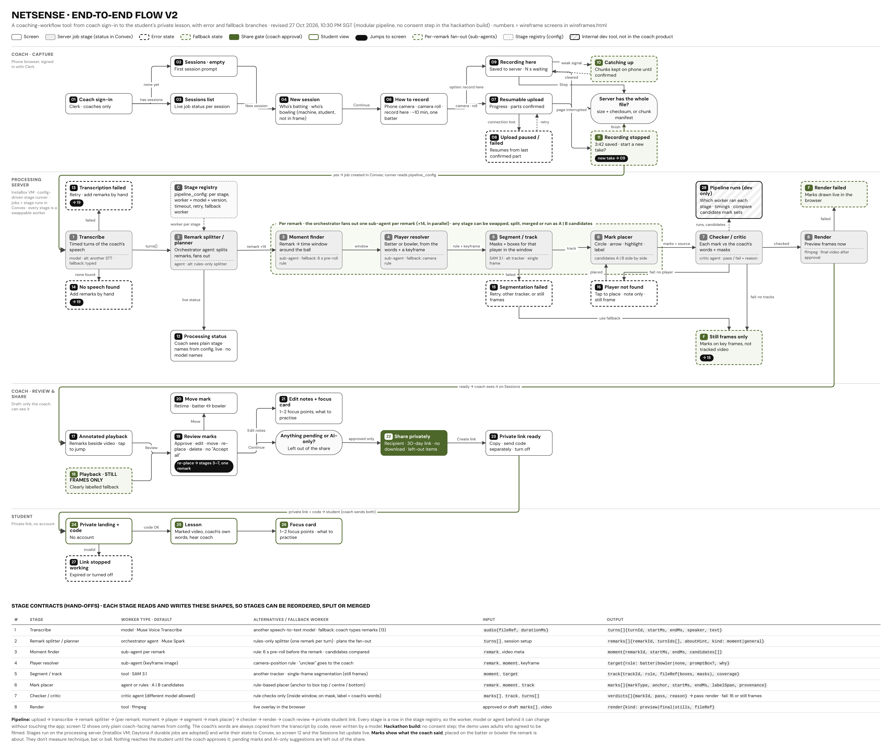
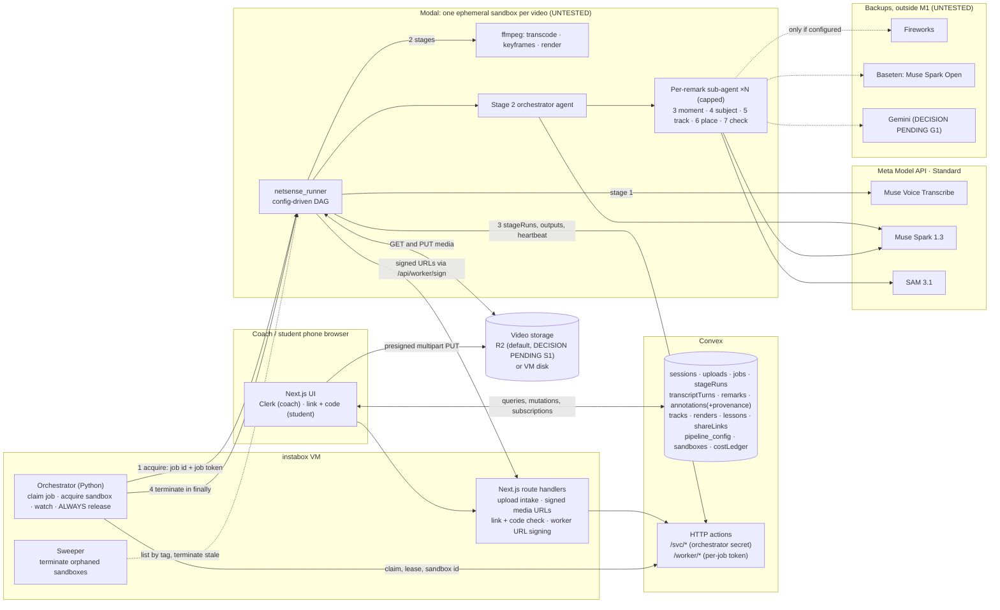

# NetSense: product and technical spec (build spec v1.1)

Written Wed 28 Oct 2026 (SGT, UTC+8) for the coding agent (Codex) and for Bala Sivagnanam. This is the build contract for the hackathon version of NetSense. It comes from `PROPOSAL.md` R10 and the Product Designer's flow v2 (`design/flow-v2/README.md`, wireframes in `docs/design/`), which are not in this repo. Where they disagree, §20 gives the resolution.

> **Capability caveat.** Every Meta model, Modal, Convex, Clerk, R2 and instabox capability below comes from vendor docs and is **UNTESTED** for NetSense until the M0 feasibility spike (TASKS.md `T0.*`). Every timeout, cap and cost figure is an unmeasured default that you tune after the spike. If a vendor API turns out to differ from what is written here, follow the vendor's current docs, keep the contract in this spec, and log the change in RUNBOOK.md "Log / refinements".

> **Revision v1.1 (Wed 28 Oct 2026, 3:05 PM SGT, Bala's input).** (1) **One person in focus:** tracking follows a single subject the coach selects by tapping them on a frame (screen 07a, new). SAM 3.1 tracks that one person; everyone else is ignored. Batter or bowler is a role label on that subject, not two tracks. This is a scope reduction (DECISIONS.md `F1`). (2) The aim now is "ready to test": TASKS.md starts with a chunk that needs no paid keys.

> **Pending decisions** are marked `DECISION PENDING (Bala)` with a default. Build the default and keep it configurable. The full list is in DECISIONS.md.

Contents: 0 Revision v1.1 (above) · 1 Goals · 2 Non-goals and content rules · 3 Users and access · 4 Screens and flows · 5 Architecture · 6 Pipeline and stage interface · 7 Stage contracts (8 stages + transcode) · 8 Agent prompts and output schemas · 9 Convex schema · 10 Routes and APIs · 11 Modal sandbox lifecycle · 12 Storage interface · 13 Auth (Clerk) · 14 Student link access · 15 Error states per screen · 16 Observability · 17 Config and feature flags · 18 Cost guards · 19 Testing plan · 20 Contradictions resolved · 21 Demo video needs · 22 Scope: M0, M1, cut order, extras.

---

## 1. Goals

NetSense is a coaching-workflow web app for cricket coaches, used in a phone browser. The coach films a net session while talking through feedback. NetSense turns the coach's own spoken remarks into a marked-up video and notes. The coach checks and approves everything, then shares a private lesson link with the student.

The demo must prove (HANDOFF): **record a session with spoken coaching → draft lesson → coach review → student opens a private link → coach sees the next-session focus.** Between drafting and review sits the marked-up video (core scope, Bala, 27 Oct).

Product goals:
1. **Capture is easy.** Camera app plus resumable upload from the camera roll; processing starts only after the server confirms the whole file.
2. **Every mark points to something the coach said.** Each annotation shows, on the one person the coach selected and at the right moment, a remark the coach made. Labels are the coach's words, copied from the transcript in code, or a neutral pointer ("Batter", "Bowler", "Remark 3").
3. **The coach is in charge.** AI placements and AI suggestions are drafts (dashed) until the coach approves each one. There is no bulk approve. Only approved items reach the student.
4. **The student gets a private, focused lesson.** Link plus 6-digit code, marked-up moments, "Hear coach" (original audio), 1–2 focus points.
5. **Meta models do distinct, visible jobs** (Stage One pass/fail, Tooling 25%): Muse Voice Transcribe (speech → timed turns), Muse Spark (orchestrator and per-remark agents), SAM 3.1 (segment and track the one selected person, whether batting or bowling).
6. **The pipeline is sound engineering** (Technical Depth 20%): 8 swappable stages behind one interface, a versioned `pipeline_config` registry, `stageRuns` for every attempt, `annotations.provenance` on every mark, one ephemeral Modal sandbox per video that is always released.

Judging weights the build serves: Impact 30%, Meta AI Tooling 25%, Technical Depth 20%, Demo 25%. Stage One is pass/fail on meaningful use of Meta models.

## 2. Non-goals and content rules

Non-goals (not built, not claimed):
- Only one person is tracked per session: the subject the coach selects (F1). No multi-person tracking, no automatic batter/bowler pairing.
- No bat, ball, bat-speed, angle, distance or biomechanics tracking or analysis. No technique scores. NetSense is not an AI coach and not a video analyser.
- No payments, attendance, marketing, academy admin, multi-student dashboard, guardian accounts.
- No in-app consent step in the hackathon build (C-C, `DECISION PENDING (Bala)`, see §3).
- No Meta glasses integration. Glasses are mentioned only as a possible future capture option.
- Daytona is not used.

Content rules (apply to UI copy, README, write-up, demo video, commit messages, seed data):
- Pitch to cricket coaches in general. Never write "community cricket". Make no claim about how many coaches are part-time.
- Say "coaching-workflow tool that turns the coach's own commentary into marked-up video and notes". Never "AI coach" or "video analyzer"; processing copy says "matching", "follow", "place and check", never "analysing".
- No untested capability claims. Quote spike numbers where a claim is made. "Still frames only" is always described as a fallback.
- Model names never appear on coach or student screens (only in the README, write-up, and the dev-only screen 28 if built).
- No placeholder, fake or example data in anything that ships. Any seed or demo data is real (consented adults) and is labelled on screen as a fallback (§22.4). Test fixtures live under `fixtures/synthetic/` and are never loaded by the app.
- Student pages carry the footer: "These marks show what your coach said. They don't measure your technique."
- Footage, transcripts, masks and tracks of real people are never committed to the repo.

## 3. Users and access

| Role | How they get in | What they can do |
|---|---|---|
| Coach | Clerk sign-in (Google or email code), screen 01 | Create sessions, upload, watch processing, review and approve, share, turn links off |
| Student | Private link plus 6-digit code, no account (screens 24–27) | View one approved lesson snapshot until it expires or is turned off |
| Dev (Bala) | Clerk user with `publicMetadata.role = "dev"` and `FEATURE_DEV_RUNS_VIEW` on | Screen 28 (extra, not M1) |

People filmed: in the hackathon build every person in the footage is an adult who agreed to be filmed, recorded off-app (D2). No minors (D3). `DECISION PENDING (Bala)`: C-C "no in-app consent step" is reported by the Product Designer as Bala's decision and awaits his confirmation. Default: no consent step; screen 22 shows "Hackathon build: demo uses adults who agreed to be filmed. A consent step for juniors comes in a later version." The schema keeps `consents` and `sessions.consentCheck` as **later** (not created in M1).

## 4. Screens and user flows

Wireframes: `docs/design/wireframes/NN-slug.png` (low-fi; every board carries an "Example data" chip because the names and words in them are examples, **do not copy any of that text into the product**). End-to-end flow: `docs/design/flow.png`. Screen 05 was removed; its number stays free.



Visual rules for every screen:
- Coach's words are solid: a dark quote block headed "COACH SAID · mm:ss", text copied from `transcriptTurns` by `turnId` in code.
- AI placement is dashed: "◇ AI-placed". After the coach moves or places a mark it becomes solid "● Placed by you" (student sees "Placed by coach").
- AI suggestions (focus points, drills, notes not from one remark) are dashed cards with "Not something you said", a **Why:** line, and are left out of the share until approved. Approved ones keep "AI-suggested · approved by coach".
- Coach vs AI differ by shape and label, never by colour alone.
- Accent `#4D672A` only for the main action, the active item and the fallback badge; the rest greyscale (wireframe palette; the final palette may come from the design system, keep the rule).
- No "Accept all" anywhere.

### 4.1 Coach · capture

| # | Screen (wireframe) | Route | Purpose and data | Actions | Errors |
|---|---|---|---|---|---|
| 01 | Coach sign-in (`01-coach-sign-in.png`) | `/sign-in` | Clerk sign-in; creates `coaches` row on first sign-in. Page says "Coaches only". | Continue with Google, Email code | Clerk inline errors; offline: "No connection, try again" |
| 02 | Sessions · empty (`02-sessions-empty.png`) | `/sessions` (no rows) | First run. Three "before you start" points: about 10 min, keep your player in frame; only film people who agreed to be filmed; talk about what you see as you film. (Wireframe text differs: it predates the one-person decision.) | + New session | none |
| 03 | Sessions list (`03-sessions-list.png`) | `/sessions` | One row per session with live status from the latest `jobs` row. Filters All / Needs you / Shared. Row tap routes by state: processing → 12, review ready → 17, error → 13–16, shared → 23. | filter, open row, + New session | "! Fix" badge for failed sessions; "Still frames only" label for stills sessions; "Upload failed" after 3 upload attempts |
| 04 | New session (`04-new-session.png`, **changed in v1.1**) | `/sessions/new` | Pick **who this lesson is for** (existing students or + Add a student by label) and what they are doing: **Batting / Bowling / Other**. Writes `sessions.studentId`, `sessions.subjectRole`. The wireframe's separate bowler picker is dropped (one person in focus, F1). No consent badges. | select, + Add a student, pick role, Continue | Continue disabled until a student and role are picked |
| 06 | How to record (`06-how-to-record.png`) | `/sessions/[id]/record` | Main: Record with phone camera (`<input type="file" accept="video/*" capture="environment">`); Upload from camera roll (`<input type="file" accept="video/*">`). In-page recording is an **extra** (X1), hidden in M1. Writes `sessions.captureMode`. | Open camera, Pick clip | Hide in-page option when MediaRecorder is missing (X1 only) |
| 07a | **Pick who to follow** (new in v1.1, no wireframe yet; design gap flagged to Bala) | `/sessions/[id]/subject` (shown alongside 07 while the upload runs) | The browser decodes the chosen file locally (`<video>` + canvas, no network) and shows a frame scrubber. The coach scrubs to a frame where their player is clear and **taps the person**. Writes `sessions.subject = {frameMs, point: {x, y} (0–1), role, selectedBy: "coach", selectedAt}` via `sessions.setSubject`. Copy: "Tap the player to follow. Other people in the video are ignored." | scrub, tap, Retake tap, Confirm | No frame decodes in the browser (some HEVC on Android) → "Pick after upload": the step reappears on 12 using the server key frames once transcode finishes. The pipeline does not start until both the upload is complete and a subject is set. |
| 07 | Upload progress (`07-upload-progress.png`) | `/sessions/[id]/upload` | Resumable multipart upload; progress counts only parts the server confirmed (`uploads.bytesConfirmed`, `partsConfirmed`). | Pause, Cancel (asks first) | Dropped connection or app switch → 08 |
| 08 | Upload paused / failed (`08-upload-failed.png`) | same route, state | "Nothing is lost": confirmed parts are kept; retry with backoff. | Retry now, Choose the clip again (matched by SHA-256) | After 3 attempts Sessions shows "Upload failed"; checksum mismatch on re-pick: "This isn't the same clip" |
| 09–11 | In-page recording (`09`, `10`, `11`) | `/sessions/[id]/record/live` | **Extra X1, option only, not in M1.** Spec in §22.3. | | |

### 4.2 Processing (shown to the coach)

| # | Screen | Route | Purpose and data | Actions | Errors |
|---|---|---|---|---|---|
| 12 | Processing status (`12-processing-status.png`) | `/sessions/[id]/status` | Coach stages from `pipeline_config.coachStages`, live from `jobs.coachStage`, `progress`, `progressLabel` (e.g. "9 of 14"): **Upload, Hear your remarks, Match remarks to moments, Follow your player, Place and check marks, Prepare preview**. "Only you can see this draft." No model names. | Back to Sessions (coach can close the app) | A failed coach stage swaps in 13–16; silent internal retries are not shown |
| 13 | Transcription failed (`13-transcription-failed.png`) | `/sessions/[id]/status` (state) | Video is safe. `jobs.errorCode` in `AUDIO_DECODE`, `TRANSCRIBE_FAILED`. | Try transcribing again (re-queues stage 1 only), Add remarks by hand (`remarks.source = "typed"`, no Hear coach) | After 3 attempts session shows "Needs you" |
| 14 | No speech found (`14-no-speech-found.png`) | same | `NO_SPEECH`: audio fine, zero turns; later stages skipped. | Add remarks by hand, Keep video without marks | Never invents remarks |
| 15 | Segmentation failed (`15-segmentation-failed.png`) | same | `SEG_NO_TRACK` at session level (§7.6 routing). Remarks are kept. | Use still frames only (`sessions.renderMode = "stills"` → 18), Retry tracking (stage 5 only, same worker in M1) | Stage 2–4 outputs are kept |
| 16 | Player not found (`16-player-not-found.png`) | `/sessions/[id]/review?remark=` or inline on 12/19 | The selected person could not be found, or tracking swapped to someone else, at one remark's moment (`annotations.status = "player_missing"`, codes `SUBJECT_NOT_FOUND`, `SUBJECT_SWAP`), raised by stage 4, 5 or 7. Never blocks other remarks. | Tap them on this moment's frame (point prompt → stages 5–7 for that remark, `remark_retrack` job), Note only (`mode = "note_only"`), Still frame (that remark only), Decide later in review | Other marks continue as tracked video |

Typed remarks (13/14): the coach types a remark and picks the time on the scrubber and the role. It is stored as `remarks.source = "typed"` with a synthetic `turnId` prefixed `typed-`; stages 3–7 then run for it in a `remark_retrack` job. Hear coach is hidden for typed remarks.

### 4.3 Coach · review and share

| # | Screen | Route | Purpose and data | Actions | Errors |
|---|---|---|---|---|---|
| 17 | Annotated playback (`17-annotated-playback.png`) | `/sessions/[id]/playback` | Marked video (preview render if ready, else live overlay from `annotations` + track files), remarks list below (beside on wide screens); active remark highlighted; tap to jump. Timeline markers: solid = coach-placed, dashed = AI. | play, seek, tap remark, Review marks (N need you) | Render missing or failed → live overlay, same screen |
| 18 | Playback · Still frames only (`18-still-frames-only.png`) | same, `renderMode = "stills"` | Marks drawn on key frames, thumbnail strip, banner that cannot be dismissed: **"Still frames only"**. | tap a frame, Play video (no marks), Review marks | Never presented as tracked video; student sees the same banner |
| 19 | Review marks (`19-review-marks.png`) | `/sessions/[id]/review` | One card per mark: "COACH SAID · mm:ss" quote, mark type and role, AI-placed tag, time range, **Why here:** line (`annotations.why`), status. Tabs: Needs you / Approved / AI suggestions. | Approve, Edit (mark type, neutral label choice, or transcription fix marked "corrected by coach"), Move (→ 20), Delete (undo), Dismiss suggestion, Edit notes (→ 21), Continue to share (→ 22), **Change who to follow** (back to 07a on any frame; enqueues a `subject_retrack` job that re-runs stages 4–8 for every remark and resets AI marks to "Needs you"; coach-placed marks are kept). **Re-place this mark is an extra (X4), hidden in M1.** | No bulk approve; unapproved items are left out of the share |
| 20 | Move mark (`20-move-mark.png`) | `/sessions/[id]/review/[annotationId]/move` | Retime (dashed = AI range kept in `aiPlacement`, solid = coach range) or set No one (note only); change mark type. Coach's words never change. There is no reassign to another person (one person in focus, F1; the wireframe's Batter/Bowler switch is dropped). | ±0.5 s, drag, note only, pick mark type, Save and approve | If the selected person has no track at that time, offer the 16 options. Only the affected segment is re-rendered at final render |
| 21 | Edit notes + focus card (`21-edit-notes.png`) | `/sessions/[id]/review/notes` | Coach's note (free text, solid), focus points (1–2), practice list (cut 6 removes it). AI drafts dashed with Why lines. | edit, Approve / Edit / Dismiss each AI item, + Add your own drill, Done | A third focus point is blocked |
| 22 | Share privately (`22-share-privately.png`) | `/sessions/[id]/share` | Recipient (the student's label and masked contact if on file), what is shared and what is left out (pending marks, unapproved AI suggestions, remarks not about the selected person by default), link stops after 30 days, download off, 6-digit code required. Carries: "Hackathon build: demo uses adults who agreed to be filmed. A consent step for juniors comes in a later version." | Create private link | Left-out items are never in the snapshot |
| 23 | Private link ready (`23-link-ready.png`) | `/sessions/[id]/share/ready` | Link and code shown once (code is never stored in clear), sent by the coach from their own phone. Shows Opened (`openedAt`) and stop date. Next-session focus card for the coach (§4.5). | Copy link, Copy code, Share… (Web Share API), Turn off link, Back to Sessions | Turn off sets `revokedAt`; student then sees 27 |

### 4.4 Student (no sign-in)

| # | Screen | Route | Purpose and data | Actions | Errors |
|---|---|---|---|---|---|
| 24 | Private landing + code (`24-student-landing.png`) | `/l/[token]` | "[Coach display name] shared a lesson", "Only you and your coach can see this", 6-digit code entry. `noindex`, title carries no name. | enter code, Open lesson | Wrong code inline; 5 wrong codes lock 15 min ("Try again in 15 minutes"); expired or turned off → 27 |
| 25 | Lesson (`25-student-lesson.png`) | `/l/[token]/lesson` | Marked video (final MP4 if present, else proxy + live overlay of approved annotations), "This week's focus" strip, coach's words at each moment with **Hear coach** (original audio slice) and placement tags. Footer: "These marks show what your coach said. They don't measure your technique." | play, tap to jump, Hear coach, Open focus | Stills lesson shows the 18 banner; render missing → live overlay |
| 26 | Focus card (`26-student-focus-card.png`) | `/l/[token]/focus` | 1–2 approved focus points, each with the coach's quote and "Watch the moment"; approved practice list (AI drill keeps its tag). | Watch the moment, tick drills (localStorage only), Back to video | No scores or progress claims |
| 27 | Link stopped working (`27-link-stopped.png`) | `/l/[token]` (state) | One neutral page for expired or turned-off links; reveals nothing about the lesson; tells the reader to ask their coach. | none | Lockout uses a separate "Try again in 15 minutes" message |

### 4.5 Next-session focus (coach)

After the coach approves and shares, the `finalize` job (§11) asks Muse Spark to draft **one next-session focus card** from the approved lesson only (approved remarks, approved focus points, coach notes). It is shown to the coach on 23 and on the session row as an AI suggestion (dashed, Why line) that the coach accepts or edits. It is stored in `lessons.nextSessionFocus`. It is never shown to the student unless a later version adds that.

### 4.6 Internal

**28 Pipeline runs (dev only)** (`28-pipeline-runs-dev.png`): **extra X5** (cut 3). Route `/dev/runs/[jobId]`, gated by `FEATURE_DEV_RUNS_VIEW` and Clerk role `dev`; no link from coach or student screens. In M1, the same data is visible in the Convex dashboard (`stageRuns`) and via `pnpm runs:show <jobId>` (RUNBOOK).

---

## 5. Architecture

Stack (Bala's decisions): **instabox VM** hosts the web app, the HTTP API and the orchestrator. **Convex** is the database and real-time status. **Clerk** authenticates coaches. **One ephemeral Modal Sandbox per uploaded video** runs that video's whole pipeline and is always released; the final MP4 render after approval runs in a fresh sandbox. **Meta Model API** (Standard mode, `https://api.meta.ai/v1`) serves Muse Voice Transcribe, Muse Spark and SAM 3.1. Fireworks and Baseten are swappable backup providers outside M1.

Implementation choices made by this spec (not from Bala; change only with a DECISIONS.md entry):
- Web app and VM HTTP API: **Next.js (App Router, TypeScript)** in `apps/web`, one process on the VM.
- Orchestrator and sweeper: **Python 3.12** service in `services/orchestrator` (Modal's documented SDK is Python).
- Runner inside the sandbox: **Python 3.12** package `runner/netsense_runner` (ffmpeg, OpenAI SDK pointed at Meta, `meta-sam-parser`, Pillow).
- Shared contracts: **JSON Schema** files in `packages/contracts/schemas/`, generated into TypeScript types and Pydantic models. The JSON Schemas are the single source of truth.
- Workspace: pnpm (Node 22) + uv (Python).



Five-line summary:
1. The phone uploads the clip straight to private storage with resumable multipart while the coach taps the one person to follow on a frame; once the VM API confirms the size and the subject is set, Convex creates a `jobs` row.
2. The VM orchestrator claims the job, starts one named Modal sandbox for that video with a job-scoped token, and watches its heartbeat.
3. Inside, a config-driven runner runs transcode → 1 transcribe → 2 orchestrator agent → per-remark fan-out of 3–7 → 8 preview render, writing every attempt to `stageRuns` and every output to Convex/storage as it finishes.
4. The orchestrator always terminates the sandbox (success, failure or timeout) and a sweeper kills orphans; the coach reviews with no sandbox held, then a fresh sandbox renders the final MP4 and drafts the next-session focus.
5. The student opens a link plus 6-digit code; the VM API checks it and hands out short-lived signed media URLs for the approved snapshot only.

Two runtime switches keep the plan alive if a vendor fails:
- `SANDBOX_DRIVER = modal | local` — `local` runs the same runner as a subprocess on the VM (R9 shape) if Modal credits do not arrive or Modal fails the spike. Same contracts, no sandbox lifecycle.
- `STORAGE_DRIVER = r2 | local` — `local` keeps video on the VM `/data` disk (cut 11).

---

## 6. Pipeline and the stage interface

### 6.1 Stage list

| # | Stage key | Worker type | M1 default worker id | Provider · model | Fan-out | Coach row (screen 12) |
|---|---|---|---|---|---|---|
| 0 | `transcode` (pre-stage) | tool | `transcode.ffmpeg@1` | ffmpeg | none | Upload |
| 1 | `transcribe` | model | `transcribe.muse-voice@1` | meta · `muse-voice-transcribe-1.0` | none | Hear your remarks |
| 2 | `plan` (remark splitter / planner) | agent (orchestrator) | `plan.spark@1` | meta · `muse-spark-1.3` | none (creates fan-out) | Match remarks to moments |
| 3 | `moment` | sub_agent | `moment.spark@1` | meta · `muse-spark-1.3` (image) | per_remark | Match remarks to moments |
| 4 | `subject` (subject resolver; was "player resolver") | sub_agent | `subject.spark-sam@1` | meta · `sam-3.1` (image: anchor + candidates) + `muse-spark-1.3` (image: re-identify) | per_remark (plus one session-level anchor step) | Match remarks to moments |
| 5 | `track` (segment / track) | tool | `track.sam31@1` | meta · `sam-3.1` (video window) | per_remark | Follow your player |
| 6 | `place` (mark placer) | sub_agent | `place.spark@1` | meta · `muse-spark-1.3` | per_remark | Place and check marks |
| 7 | `check` (checker / critic) | rules | `check.rules@1` (critic `check.spark-critic@1` disabled) | local rules | per_remark | Place and check marks |
| 8 | `render` | tool | `render.ffmpeg@1` | ffmpeg + Pillow | none (per segment inside) | Prepare preview |

`transcode` is listed as a pre-stage so the 8 stage numbers match the design. It has its own `stageRuns` rows.

### 6.2 Stage interface (Python, `runner/netsense_runner/stage.py`)

```python
from typing import Protocol, Literal, Any
StageKey = Literal["transcode","transcribe","plan","moment","subject","track","place","check","render"]
WorkerType = Literal["agent","sub_agent","model","tool","rules"]

class StageContext(Protocol):
    job_id: str; session_id: str; config_version: int
    stage_run_id: str; remark_id: str | None; attempt: int
    deadline_monotonic: float           # from stage timeoutMs
    budget: "Budget"                    # SAM frames, Spark tokens, USD; raises BudgetExceeded
    storage: "WorkerStorage"            # get_url(key), put_bytes(key, data, content_type), put_file(...)
    convex: "WorkerApi"                 # job-token scoped calls (§10.4)
    providers: "ProviderRegistry"       # meta | fake | gemini | fireworks | baseten
    log: "Logger"                       # structured JSON, never logs secrets or transcript text

class StageResult(TypedDict):
    status: Literal["done","failed","needs_coach","skipped"]
    output: dict[str, Any] | None       # must validate against the output contract
    error_code: str | None
    usage: dict                         # {"samFrames":int,"inputTokens":int,"outputTokens":int,"audioSeconds":int}
    cost_usd: float
    trace: dict | None                  # agentTraces payload: toolCalls, framesViewed, whyThisPlayer

class StageWorker(Protocol):
    id: str                 # e.g. "moment.spark@1"
    stage: StageKey
    worker_type: WorkerType
    input_contract: str     # schema file name, e.g. "MomentInput"
    output_contract: str    # e.g. "MomentOutput"
    def run(self, input: dict, ctx: StageContext) -> StageResult: ...
```

Boundary rules (enforced by the runner, not by workers):
1. Validate `input` against `input_contract` before `run`; validate `output` after. A contract violation is `CONTRACT_INVALID` and counts as a failed attempt.
2. Idempotency key = `sha256(jobId | stage | remarkId | workerId | sha256(canonical_json(input)))`. If a `stageRuns` row with that key is `done` and its `outputRef` exists, skip and reuse (resume after re-acquire; no double charge).
3. Each attempt writes one `stageRuns` row: `queued → running → done | failed | fallback | skipped | needs_coach`.
4. Timeout = `timeoutMs` from config; on timeout the attempt is `failed` with `STAGE_TIMEOUT`.
5. Retries = `retry` from config with backoff 2 s, 8 s. Then `fallbackWorker` if set (M1: only the screen fallbacks, §6.4). Then route per §7.
6. Workers never write directly to Convex tables; they return output and the runner persists it through `/worker/*`.

Adapters (`runner/netsense_runner/adapters/`):
- `AgentAdapter`: chat completion with `response_format={"type":"json_schema","json_schema":{"name":..., "schema":..., "strict":true}}`, optional images as base64 data URLs, provider-neutral. Used by stages 2, 3, 4, 6, 7-critic.
- `ModelApiAdapter`: non-chat model endpoints (Voice Transcribe multipart; SAM 3.1 Responses API streaming).
- `ToolAdapter`: subprocess tools (ffmpeg, ffprobe) with timeout and stderr capture.
- `RulesAdapter`: pure Python functions (checker, neutral label from `subjectRole`, swap guard, stills routing).

### 6.3 Provider registry and model provider config

`ProviderRegistry` maps `provider` → client. Every agent stage reads `provider` and `model` from `pipeline_config`, so the model provider is a config value.

| provider | Status | Used for | Env |
|---|---|---|---|
| `meta` | **default, M1** | all stages | `MODEL_API_KEY`, `META_API_BASE_URL` |
| `fake` | tests only; refuses to load when `NETSENSE_ENV=prod` | deterministic outputs from `fixtures/synthetic/` | none |
| `gemini` | `DECISION PENDING (Bala)` G1, due **Thu 29 Oct 2026**. Default: not used. Adapter stub only; implement in X7 if G1 = yes | agent stages 2, 3, 4, 6, 7 only | `GEMINI_API_KEY` |
| `fireworks` | extra X6, outside M1 | backup agent stages | `FIREWORKS_API_KEY` |
| `baseten` | extra X6, outside M1 (model id to confirm in the Baseten console when credits arrive) | backup / compare worker | `BASETEN_API_KEY` |

`AGENT_PROVIDER_DEFAULT` (env) is used only when seeding a new config version; a running job always uses its pinned config. Any non-Meta model used must be disclosed in the README and write-up (D9).

### 6.4 Fallbacks in M1

Only the fallbacks the screens already need:
- Stage 1 fails after retries → screen 13 (retry or typed remarks). No speech → 14.
- Stage 4 cannot re-find the selected person in a remark's window → `player_missing` (`SUBJECT_NOT_FOUND`) → 16.
- Stage 5 fails for a remark → that remark `player_missing` with reason `SEG_NO_TRACK` → 16 options. Session-level "no usable tracks" (§7.6) → 15 → coach chooses Still frames only → 18.
- Stage 7 fails a mark → subject not found or swapped to another person: 16; no usable track: counts toward the session-level rule.
- Stage 8 fails → `RENDER_FAIL`, no screen; 17/25 draw the live overlay.
Extra fallback workers (rules splitter, moment heuristic, rules placer, alternate ASR, alternate segmenter) are X3 (cut 5). The `fallbackWorker` field stays in the schema, set to `null`.

### 6.5 DAG and fan-out

```
transcode → transcribe → plan → subject anchor ─┬─ remark r1: moment → subject → track → place → check ─┐
                                                ├─ remark r2: ...                                        ├→ render(preview) → waiting_for_coach
                                                └─ remark rN: ...                                        ┘
```
- Fan-out concurrency cap `FANOUT_CONCURRENCY` (default 4) per job, a thread pool in the runner.
- One remark failing never blocks others; render waits for all remark branches to reach a terminal state.
- **One person in focus (F1).** Only the selected subject is ever tracked or marked. Remarks with `aboutSubject = "no"` (about someone else) or `"general"` skip 3–7 and become note-only (`mode = "note_only"`); by default they are left out of the share. `aboutSubject = "unclear"` remarks are tracked and flagged "Needs you".
- The job starts only when the upload is complete **and** `sessions.subject` is set (whichever happens second enqueues it).
- Still-frames mode (`sessions.renderMode = "stills"`): stage 5 runs `track.sam31@1` in `still` mode (one key frame, image request); stage 8 renders stills.
- Job kinds: `pipeline` (full DAG), `subject_retrack` (coach changed who to follow: subject anchor + stages 4–8 for every remark; stage 1–3 outputs reused), `remark_retrack` (stages 3–7 or 5–7 for one remark, from 16 "Tap them", typed remarks, or Retry tracking), `stage_retry` (one stage, from 13 or 15), `finalize` (final render + next-session focus draft after approval). Every kind gets its own sandbox and is released the same way.

---
## 7. Stage contracts (JSON input and output)

The schemas below are the contracts. Write them as JSON Schema draft 2020-12 files in `packages/contracts/schemas/<Name>.json` with `additionalProperties: false` throughout. Shorthand: `ms` = integer milliseconds from the start of the proxy video; `FileRef` = storage key string, e.g. `sessions/{sessionId}/tracks/{remarkId}.json`. All ids are strings.

Shared types (`Common.json`):
```json
{
  "SubjectRole": {"enum": ["batter", "bowler", "other"], "description": "a label on the one selected person, not a second track"},
  "Subject": {"type": "object", "properties": {"frameMs": {"type": "integer"}, "point": {"type": "object", "properties": {"x": {"type": "number", "minimum": 0, "maximum": 1}, "y": {"type": "number", "minimum": 0, "maximum": 1}}, "required": ["x","y"]}, "role": {"$ref": "#/SubjectRole"}, "selectedBy": {"enum": ["coach"]}, "selectedAt": {"type": "integer"}}, "required": ["frameMs","point","role","selectedBy","selectedAt"], "description": "the one person to follow, tapped by the coach on screen 07a; point is normalised to the frame"},
  "MarkType": {"enum": ["circle", "arrow", "highlight", "label"]},
  "Anchor": {"enum": ["box_center", "box_top", "box_bottom", "box_left", "box_right"]},
  "ArrowFrom": {"enum": ["left", "right", "above", "below"]},
  "NeutralLabel": {"enum": ["Batter", "Bowler", "Player", "Remark"], "description": "Batter/Bowler/Player follow sessions.subjectRole"},
  "Box": {"type": "object", "properties": {"x1": {"type": "number"}, "y1": {"type": "number"}, "x2": {"type": "number"}, "y2": {"type": "number"}}, "required": ["x1","y1","x2","y2"], "description": "pixels in proxy video frame space"},
  "TextSpan": {"type": "object", "properties": {"turnId": {"type": "string"}, "start": {"type": "integer", "minimum": 0}, "end": {"type": "integer", "minimum": 1}}, "required": ["turnId","start","end"], "description": "UTF-16 code unit offsets into transcriptTurns.text"},
  "Provenance": {"type": "object", "properties": {"configVersion": {"type": "integer"}, "stageRunIds": {"type": "object", "additionalProperties": {"type": "string"}}, "workers": {"type": "object", "additionalProperties": {"type": "string"}}, "modelVersions": {"type": "object", "additionalProperties": {"type": "string"}}, "placedBy": {"enum": ["ai", "coach"]}, "candidate": {"type": ["string", "null"]}}, "required": ["configVersion","stageRunIds","workers","modelVersions","placedBy","candidate"]}
}
```

### 7.0 transcode (pre-stage, tool)
Input `TranscodeInput`:
```json
{"uploadId": "string", "sourceKey": "FileRef", "declaredBytes": 0, "declaredSha256": "hex", "mimeType": "string"}
```
Output `TranscodeOutput`:
```json
{"proxyKey": "FileRef", "audioWavKeys": [{"key": "FileRef", "offsetMs": 0, "durationMs": 0}],
 "audioM4aKey": "FileRef", "durationMs": 0, "width": 0, "height": 0, "fps": 0.0, "frameCount": 0,
 "keyframeIndexKey": "FileRef", "sha256Verified": true}
```
Steps: download by signed URL; verify byte size and SHA-256 against `uploads` (mismatch → `UPLOAD_CHECKSUM`, back to screen 08); `ffprobe`; proxy `ffmpeg -i src -vf scale=-2:720 -c:v libx264 -preset veryfast -crf 23 -c:a aac -b:a 96k -movflags +faststart proxy.mp4` (also normalises HEVC/WebM input); WAV chunks `ffmpeg -i proxy.mp4 -ac 1 -ar 24000 -c:a pcm_s16le -map_metadata -1` split into ≤9 min 30 s pieces (Voice Transcribe limit is 10 min and 32 MB); `audio.m4a` for Hear coach; key frames as JPEG at 2 fps, 640 px wide, indexed in `keyframes.json` (`[{idx, ms, key}]`). Errors: `AUDIO_DECODE` (no audio stream), `VIDEO_DECODE`, `UPLOAD_CHECKSUM`. Timeout 300 s, retry 1.

### 7.1 Stage 1 · transcribe (model)
Input `TranscribeInput`:
```json
{"audioWavKeys": [{"key": "FileRef", "offsetMs": 0, "durationMs": 0}],
 "keywords": ["batter", "bowler", "front foot", "back foot", "follow-through", "run-up", "crease", "line", "length"],
 "languageBias": ["English"]}
```
Output `TranscribeOutput`:
```json
{"turns": [{"turnId": "t001", "startMs": 0, "endMs": 0, "speaker": "string", "text": "string"}],
 "audioDurationMs": 0, "providerSessionIds": ["string"]}
```
Call: `POST {META_API_BASE_URL}/asr/transcribe` multipart, part `request` = `{"mode":"DIARIZATION","model":"muse-voice-transcribe-1.0","audioEncoding":"WAV","keywords":[...],"languageBias":["English"]}`, part `audio` = WAV bytes. Add each chunk's `offsetMs` to its turn times; number `turnId`s in order across chunks. Keywords are spelling hints from config plus the session's student labels (labels only, never contact details). Empty `turns` → status `needs_coach`, `NO_SPEECH` (14). HTTP 400/413 → `AUDIO_DECODE` (no retry); 429 → backoff and retry; 500 → retry once; otherwise `TRANSCRIBE_FAILED` (13). Turn timestamps are turn level only; no word timings are assumed. Persist each turn as a `transcriptTurns` row; `text` is immutable after write (coach corrections go to `correctedText`). Timeout 120 s per chunk, retry 2.

### 7.2 Stage 2 · plan (orchestrator agent)
Input `PlanInput`:
```json
{"session": {"studentLabel": "string", "subjectRole": "batter|bowler|other"},
 "turns": [{"turnId": "t001", "startMs": 0, "endMs": 0, "speaker": "string", "text": "string"}]}
```
Model output `PlanModelOutput` (what Muse Spark returns, §8.2):
```json
{"coachSpeaker": "string",
 "remarks": [{"turnIds": ["t003"], "aboutSubject": "yes|no|unclear|general", "kind": "feedback|instruction|praise|other", "aboutHint": "string"}],
 "focusDrafts": [{"title": "string", "why": "string", "remarkIndexes": [0]}],
 "practiceDrafts": [{"title": "string", "why": "string", "remarkIndexes": [0]}],
 "noteDraft": {"text": "string", "why": "string"}}
```
Stage output `PlanOutput` (after code post-processing):
```json
{"remarks": [{"remarkId": "r01", "turnIds": ["t003"], "aboutSubject": "yes|no|unclear|general", "kind": "feedback|instruction|praise|other",
              "aboutHint": "string", "atMs": 0, "coachWords": "string (copied in code)"}],
 "fanOut": [{"remarkId": "r01", "stages": ["moment","subject","track","place","check"]}],
 "drafts": {"focus": [], "practice": [], "note": null}}
```
Code rules: drop turns not by `coachSpeaker`; every `turnId` must exist and belong to one remark at most; `coachWords` = the turns' `text` joined with a space, copied in code and byte-compared on persist; `atMs` = first turn `startMs`. `aboutHint` is internal only (never shown). `focusDrafts` ≤ 2. Drafts are stored with `source: "ai_draft"`, `approved: false`. Remarks not about the selected person (`aboutSubject: "no"`) are kept as note-only and default to excluded from the share (`params.otherPersonRemarksInShare: false`; this replaces the old batter/bowler question B1, see DECISIONS.md). Timeout 60 s, retry 2.

### 7.3 Stage 3 · moment (sub-agent, per remark)
Input `MomentInput`:
```json
{"remarkId": "r01", "coachWords": "string", "atMs": 0, "subjectRole": "batter|bowler|other",
 "frames": [{"idx": 0, "ms": 0, "key": "FileRef"}], "previousRemarkAtMs": 0}
```
`frames` = key frames from `atMs - 12000` to `atMs + 1000` (clamped to `previousRemarkAtMs`), at most 26 frames (2 fps), sent as images labelled with their `idx`.
Model output `MomentModelOutput`:
```json
{"startIdx": 0, "endIdx": 0, "keyIdx": 0, "alternates": [{"startIdx": 0, "endIdx": 0}], "why": "string", "confidence": "high|medium|low"}
```
Stage output `MomentOutput`:
```json
{"remarkId": "r01", "startMs": 0, "endMs": 0, "keyframeMs": 0, "keyframeIdx": 0, "candidates": [{"startMs": 0, "endMs": 0}], "why": "string", "confidence": "high|medium|low"}
```
The model picks frame indices only; code maps them to ms, enforces `startIdx ≤ keyIdx ≤ endIdx`, and caps the window at `maxMomentMs` (default 6000). `why` is the "Why here" line on screen 19; it must refer to the coach's timing and words, not technique. Timeout 30 s, retry 1. Failure → `MOMENT_FAILED` → remark `needs_coach` (coach places it on 20).

### 7.4 Stage 4 · subject resolver (session anchor + sub-agent per remark)

**One person in focus (F1, decided by Bala 28 Oct).** The coach tapped one person on one frame (screen 07a). Stage 4 finds **that same person** in each remark's moment so stage 5 can track them. It never chooses between batter and bowler; the role is a label on the subject.

**4a · Subject anchor (once per session, before fan-out).** Input `SubjectAnchorInput`:
```json
{"proxyKey": "FileRef", "subject": {"frameMs": 0, "point": {"x": 0.5, "y": 0.5}, "role": "batter|bowler|other", "selectedBy": "coach", "selectedAt": 0}}
```
Steps: extract the frame at `subject.frameMs`; SAM 3.1 image request with a **point prompt** at the tapped point (`include_confidence: "true"`, `mask_encoding: "one_bit"`); keep the object whose mask contains the point (else the highest-confidence box containing it). Save a padded reference crop and box. Output `SubjectAnchorOutput`:
```json
{"anchorBox": {"x1":0,"y1":0,"x2":0,"y2":0}, "anchorFrameMs": 0, "referenceCropKey": "FileRef", "confidence": 0.0}
```
No object at the tapped point → `SUBJECT_NEEDED`: the job ends `waiting_for_coach` and 07a asks the coach to tap again.

**4b · Re-find the subject at a moment (per remark).** Input `SubjectInput`:
```json
{"remarkId": "r01", "coachWords": "string", "subjectRole": "batter|bowler|other", "referenceCropKey": "FileRef",
 "anchorBox": {"x1":0,"y1":0,"x2":0,"y2":0}, "anchorFrameMs": 0, "keyframeKey": "FileRef", "keyframeMs": 0, "pointPrompt": null}
```
`pointPrompt` (`{x, y}`, 0–1) is present only for "Tap them" on 16; then steps 1–3 are skipped and the tap is used directly.
1. If the key frame is within `anchorReuseMs` (default 1500 ms) of the anchor frame, use `anchorBox` and skip the model.
2. Candidates: SAM 3.1 image request on the key frame with concept `"person"` (from config), boxes with confidence ≥ `minPersonConfidence`, at most 6.
3. Muse Spark gets the **reference crop** and the key frame with numbered candidate boxes and returns which number is the same person, or 0 (§8.3). A position prior (rules) breaks ties: prefer the candidate whose box centre is nearest the anchor box centre, scaled to frame size (people in a net lane move little between deliveries). If the model and the prior disagree and the model's confidence is not "high", the remark is tracked but flagged "Needs you".
Model output `SubjectModelOutput`: `{"boxNumber": 0, "why": "string", "confidence": "high|medium|low"}` (`0` = the selected person is not visible).
Stage output `SubjectOutput`:
```json
{"remarkId": "r01", "target": {"role": "batter|bowler|other", "promptBox": {"x1":0,"y1":0,"x2":0,"y2":0}, "promptPoint": null, "frameMs": 0},
 "method": "anchor_reuse|reid_model|coach_tap", "why": "string", "confidence": "high|medium|low", "candidatesCount": 0}
```
`boxNumber = 0` → status `needs_coach`, `SUBJECT_NOT_FOUND` (16). Other people in the frame are never tracked or marked. Timeout 30 s, retry 1. **UNTESTED:** re-identification across deliveries is checked in M0 (S-4).

### 7.5 Stage 5 · track (segment and track, tool)
Input `TrackInput`:
```json
{"remarkId": "r01", "mode": "video|still", "proxyKey": "FileRef", "windowStartMs": 0, "windowEndMs": 0,
 "promptFrameMs": 0, "promptBox": {"x1":0,"y1":0,"x2":0,"y2":0}, "promptPoint": null, "role": "batter|bowler|other",
 "downsampleFps": null, "proxySha256": "hex"}
```
Video mode steps: cut the window (`momentStart - 1000` to `momentEnd + 1000`) from the proxy with `-movflags +faststart` (optionally `-r 15` when `downsampleFps` is set); upload it with the Files API (`purpose=user_data`, `expires_after[anchor]=created_at`, `expires_after[seconds]=3600`); call `POST /v1/responses` with `model: "sam-3.1"`, `stream: true`, content `input_text` = box prompt on the prompt frame (`<Nf>1<|box;x1=..;y1=..;x2=..;y2=..;w=..;h=..|>`, frame number relative to the window) and `input_video` = `{file_id}`; metadata `propagation_direction: "both"`, `include_confidence: "true"`, `mask_encoding: "one_bit"`. Parse the stream with `meta-sam-parser` (≥ 0.0.6). Frame indices can be sparse and out of order: sort, map to ms. **Single subject only:** the request prompts exactly one object (the subject) and the worker keeps only that object id; any other ids in the stream are discarded. Ids can change after occlusion: if the subject's id disappears, re-associate the next object whose box IoU with the subject's last box is ≥ `reassocIouMin` (0.3), otherwise mark the frames as gaps. **No-swap guard:** a jump where consecutive subject boxes have IoU < `swapIouMin` (0.1) and the centre moves more than `swapJumpFrac` (0.25) of the frame width within 200 ms, or any re-association, sets `swapSuspected: true`; stage 7 then fails the affected marks with `subject_swap` unless the frames after the jump still match the reference crop (critic, X2) — in M1 they go to the coach (16). Delete the Files API file in `finally`.
Still mode: one SAM image request on the key frame with the same box prompt.
Stage output `TrackOutput`:
```json
{"remarkId": "r01", "trackId": "string", "role": "batter|bowler|other", "mode": "video|still",
 "fileRef": "FileRef", "maskRef": "FileRef|null", "coverage": 0.0, "framesBilled": 0, "cacheHit": false,
 "swapSuspected": false, "reassociations": 0}
```
Track file (`tracks/{remarkId}.json`, never in Convex, documents ≤ 1 MiB): `{"fps": 0, "subjectOnly": true, "frames": [{"ms": 0, "box": {...}, "conf": 0.0}], "gaps": [[startMs, endMs]], "swaps": [{"ms": 0, "reason": "jump|reassociated"}]}`. Masks (one-bit, optional) go to `maskRef` for the X8 mask highlight. `coverage` = frames with a box ÷ frames in the moment. Cache key = `sha256(proxySha256 | window | prompt | downsampleFps)`; on hit, reuse the file and bill 0 frames. Frame cap: before the call, check `budget.samFrames + windowFrames ≤ JOB_SAM_FRAME_CAP` (§18); else `BUDGET_SAM_FRAMES`. Errors: HTTP 400 → `SEG_BAD_INPUT` (no retry); empty track → `SEG_NO_TRACK`. Timeout 180 s per window, retry 1.

### 7.6 Stage 6 · place (sub-agent, per remark)
Input `PlaceInput`:
```json
{"remarkId": "r01", "coachWords": "string", "turnSpans": [{"turnId": "t003", "length": 0}], "role": "batter|bowler|other",
 "momentStartMs": 0, "momentEndMs": 0, "keyframeMs": 0, "boxAtKeyframe": {"x1":0,"y1":0,"x2":0,"y2":0}, "coverage": 0.0,
 "allowedMarkTypes": ["circle","arrow","highlight","label"], "remarkNumber": 1}
```
Model output `PlaceModelOutput`:
```json
{"marks": [{"markType": "circle|arrow|highlight|label", "anchor": "box_center|box_top|box_bottom|box_left|box_right",
            "arrowFrom": "left|right|above|below|none", "startOffsetMs": 0, "endOffsetMs": 0,
            "label": {"kind": "coach_span|neutral", "span": {"turnId": "t003", "start": 0, "end": 0}, "neutral": "Batter|Bowler|Player|Remark|none"}}],
 "why": "string"}
```
Stage output `PlaceOutput`:
```json
{"remarkId": "r01", "marks": [{"markId": "m01", "markType": "circle", "anchor": "box_top", "arrowFrom": null,
  "startMs": 0, "endMs": 0, "labelSpan": {"turnId": "t003", "start": 0, "end": 0}, "labelText": "string (copied in code)",
  "neutralLabel": null}], "why": "string"}
```
Code rules: 1–3 marks; offsets relative to `momentStartMs`, clamped to the moment; `labelText` = `transcriptTurns.text.slice(start, end)` copied in code (or the subject's role label "Batter" / "Bowler" / "Player", or "Remark {n}"); spans must sit on word boundaries and be ≤ 60 characters (trim to the nearest word inside the span, never add words). Marks never carry free coordinates: they anchor to the tracked box. `markType` must be in `allowedMarkTypes` (cut 8 sets `["circle","label"]`). Timeout 30 s, retry 1.

### 7.7 Stage 7 · check (rules checker; critic optional)
Input `CheckInput`: `{"remarkId": "r01", "marks": [PlaceOutput.marks], "trackFileRef": "FileRef", "transcriptTurns": [{"turnId","text"}], "momentStartMs": 0, "momentEndMs": 0}`
Output `CheckOutput`:
```json
{"remarkId": "r01", "verdicts": [{"markId": "m01", "pass": true, "reason": "ok|no_player|subject_swap|low_coverage|outside_moment|label_mismatch|label_too_long"}],
 "remarkStatus": "ok|player_missing"}
```
Rules (`check.rules@1`): box present on ≥ `minMarkCoverage` (default 0.6) of the mark's frames, else `low_coverage`; no `swaps` entry inside the mark's time range, else `subject_swap`; mark inside the moment; `labelText` byte-equals the transcript slice (or is an allowed neutral label); length ≤ 60. All marks failing for `no_player`/`subject_swap`/`low_coverage` → `remarkStatus = player_missing` (16, codes `SUBJECT_NOT_FOUND` / `SUBJECT_SWAP`).
Session-level routing (runner, after all branches): if the share of tracked remarks whose stage 5 ended `SEG_NO_TRACK` or `SEG_BAD_INPUT` is ≥ `stillsThreshold` (default 0.5), set `jobs.errorCode = SEG_NO_TRACK` and `waiting_for_coach` with screen 15. Critic `check.spark-critic@1` (X2) gets the key frame with the mark drawn and returns `{"pass": bool, "reason": "string"}`; `enabled: false` in M1. Timeout 20 s, retry 1.

### 7.8 Stage 8 · render (tool)
Input `RenderInput`:
```json
{"kind": "preview|final", "mode": "video|stills", "proxyKey": "FileRef", "durationMs": 0,
 "segments": [{"segmentId": "string", "startMs": 0, "endMs": 0, "annotationIds": ["string"], "hash": "hex"}],
 "annotations": [{"annotationId": "string", "markType": "circle", "anchor": "box_top", "arrowFrom": null, "startMs": 0, "endMs": 0,
                  "labelText": "string", "placedBy": "ai|coach", "trackFileRef": "FileRef"}],
 "previousSegments": [{"segmentId": "string", "hash": "hex", "key": "FileRef"}]}
```
Output `RenderOutput`:
```json
{"kind": "preview|final", "mode": "video|stills", "fileRef": "FileRef|null", "stillRefs": [{"annotationId": "string", "key": "FileRef"}],
 "segmentRefs": [{"segmentId": "string", "hash": "hex", "key": "FileRef"}], "durationMs": 0}
```
Video: a segment is each annotated time range merged with neighbours closer than 1 s. For each segment, Pillow draws per-frame RGBA overlays from the track boxes (circle = ellipse around the anchor; arrow = from `arrowFrom` side toward the anchor; highlight = translucent box; label = text plate above the box); ffmpeg overlays them on the cut segment (`-c:v libx264 -crf 23`); un-annotated stretches are stream-copied where keyframes allow, else re-encoded; concat; `-movflags +faststart`. AI-placed marks render dashed; coach-placed solid. Final render reuses segment files whose `hash` (annotation content + track ref) has not changed, so only affected segments re-render. Stills: one JPEG per annotation at the key frame. Errors → `RENDER_FAIL`; the UI falls back to the live overlay. Timeout 300 s, retry 2.

---

## 8. Agent prompts and structured output

Shared settings: `model` from config (`muse-spark-1.3`), `temperature: 0.2`, `response_format = {"type":"json_schema","json_schema":{"name":"<Name>","schema":<schema>,"strict":true}}`. Schemas obey Muse Spark limits: no recursion, nesting ≤ 10, no `allOf`/`oneOf`, `anyOf` only below the root, every object `additionalProperties: false` with all keys required (use `"none"`/empty values instead of optional keys). Images are `{"type":"image_url","image_url":{"url":"data:image/jpeg;base64,..."}}`. Audio is never sent to Muse Spark. Prompts live in `prompts/<stage>.md` with a version header; the prompt hash goes into `stageRuns.promptHash`.

### 8.0 Shared preamble

Every system prompt starts with this shared preamble (`prompts/_preamble.md`):
```
You help a cricket coach turn their own spoken remarks into marks on a training video.
Rules you must follow:
- Never judge, score or measure technique. Never mention speed, angle, distance, or bat or ball movement.
- Never write words for the coach. When you refer to what the coach said, return ids or character spans only.
- Use only what is in the input. If you are unsure, say so with confidence "low" or choose "none".
- Return only JSON that matches the schema.
```

### 8.1 Stage 2 · plan (`prompts/plan.md`)
System (after the preamble):
```
You are the planner. The input is a diarized transcript of a net session, as numbered turns.
1. Decide which speaker is the coach (the one giving remarks about the player). Return their speaker label.
2. Group the coach's turns into remarks. A remark is one piece of feedback about one moment. Most remarks are one turn;
   join consecutive turns only when they continue the same remark. Every turn id you use must appear in the input.
   Skip chat that is not about the players (greetings, counting balls, logistics).
3. The lesson is for one person: {studentLabel}, who is {subjectRole}. For each remark say whether it is about that
   person: "yes", "no" (clearly about someone else), "unclear", or "general" (no single person), and its kind.
   aboutHint: up to 6 words naming the body part or phase the coach mentioned, using only the coach's own terms.
4. Draft at most 2 focus points for the next session, each linked to the remarks that support it (remark indexes),
   with a one-line why that cites how often or when the coach said it. Draft practice items the same way (may be empty).
   Draft a short note the coach could send. Drafts are suggestions for the coach to approve; keep them in plain words.
```
User content: JSON `{"session":{...},"turns":[...]}`. Schema `PlanModelOutput` (§7.2), with `remarkIndexes` as integer arrays and `noteDraft.text` ≤ 400 chars (enforced in code).

### 8.2 Stage 3 · moment (`prompts/moment.md`)
```
You find the moment a coach's remark refers to. Coaches usually speak just after a delivery.
You get the remark's words, the time it was said, and numbered frames before it (each image is labelled with its index and time).
Pick the frame range that shows the delivery the remark is about (startIdx..endIdx, at most 6 seconds) and the single
frame that best shows it (keyIdx). If the remark mentions a phase (run-up, release, stride, shot, follow-through), pick
frames for that phase. Give up to 2 alternate ranges. why: one sentence a coach would accept, about timing and the
coach's words (for example "you said it 2 s after the delivery at 01:16"). Do not describe technique.
```
Schema `MomentModelOutput` (§7.3) with `startIdx`, `endIdx`, `keyIdx` as `{"type":"integer","enum":[<the frame indexes sent>]}` built per call.

### 8.3 Stage 4 · subject re-identification (`prompts/subject.md`)
Inputs: image 1 = the reference crop of the one person the coach selected; image 2 = one video frame with each person outlined and numbered.
```
Image 1 shows the one person the coach chose to follow (the {role}). Image 2 is a frame from the same cricket net
session; each person found is outlined and numbered. Return the number of the box around the same person as image 1.
Use clothing, build, kit (pads, gloves, helmet, bat or ball) and position in the net. Other people in the frame are
not part of this lesson. If the person from image 1 is not visible or you cannot tell, return 0.
why: one sentence on what matches (for example "same white helmet and left-handed stance"). Do not comment on technique.
confidence: high, medium or low.
```
Schema `SubjectModelOutput`: `boxNumber` as `{"type":"integer","enum":[0,1,..,n]}`, `why` string, `confidence` enum. The model only ever returns a box number; it never draws or moves a box.

### 8.4 Stage 6 · place (`prompts/place.md`)
```
You place up to 3 simple marks on the one tracked player so the student sees where and when the coach's remark applies.
The marks show what the coach said. They do not measure anything.
Mark types: circle (draws the eye to a body area), arrow (points at it from one side), highlight (shades the player),
label (shows a short span of the coach's own words). Choose the anchor on the player's box closest to the body part
the coach named (top = head and shoulders, bottom = feet, left/right = sides). Times are offsets in ms within the moment.
For a label, either choose a span of the coach's words by turnId and character offsets (at most 60 characters, whole
words) or the neutral label "{neutralLabel}" (the player's role: Batter, Bowler or Player) or "Remark". Never write your own words in a label.
why: one sentence a coach would accept, citing the coach's words.
```
Schema `PlaceModelOutput` (§7.6); `markType` enum built from `allowedMarkTypes`; `span.turnId` enum = the remark's turn ids.

### 8.5 Stage 7 · critic (X2, disabled in M1, `prompts/critic.md`)
```
The image shows a mark drawn on a video frame and the coach's remark. Does the mark sit on the one player being followed,
near the body area the coach named? Answer pass true or false with a short reason. Do not judge technique.
```
Schema `{"pass": boolean, "reason": string}`.

### 8.6 Finalize · next-session focus (`prompts/next_focus.md`)
```
From the approved lesson only (approved remarks, approved focus points and the coach's note), draft ONE focus for the
next session with this student: a title of at most 8 words in the coach's terms, and a why citing which approved
remarks support it. Do not add anything the coach did not approve.
```
Schema `{"title": string, "why": string, "remarkIds": [string]}`, with `remarkIds` as an enum of approved ids.

Agent traces: every agent call stores to `agentTraces` the prompt hash, model, input ids (never raw images), frames viewed (indices), the parsed output, `why`, token usage and latency. Raw request/response bodies are not stored (they contain transcript text and images).

---
## 9. Convex schema (`convex/schema.ts`)

Document limit is 1 MiB: tracks, masks, key frames and renders live in storage; Convex stores keys. Timestamps are `number` (epoch ms). `v.id("x")` = Convex id. All coach-owned tables carry `coachId` and every query/mutation checks it against the Clerk identity.

| Table | Fields | Indexes |
|---|---|---|
| `coaches` | `clerkUserId`, `displayName`, `createdAt` | `by_clerkUserId` |
| `students` | `coachId`, `label` (first name or nickname), `contactMasked?` (e.g. `+65 •••• 21`, optional), `createdAt` | `by_coachId` |
| `sessions` | `coachId`, `studentId: v.id("students")` (who the lesson is for), `subjectRole: "batter"\|"bowler"\|"other"`, `subject?: Subject` (§7 common types; tapped on 07a), `subjectStatus: "needed"\|"set"\|"anchored"\|"anchor_failed"`, `subjectAnchor?: {box, frameMs, referenceCropKey}`, `captureMode: "camera"\|"camera_roll"\|"in_page"`, `renderMode: "video"\|"stills"`, `isDemoFallback: boolean` (§22.4), `status: "draft"\|"uploading"\|"processing"\|"needs_you"\|"review_ready"\|"shared"\|"failed"`, `latestJobId?`, `durationMs?`, `createdAt` | `by_coachId_createdAt` |
| `uploads` | `sessionId`, `coachId`, `storageKey`, `driver: "r2"\|"local"`, `multipartUploadId?`, `mimeType`, `bytesTotal`, `bytesConfirmed`, `partSize`, `partsConfirmed: number[]`, `sha256`, `status: "in_progress"\|"paused"\|"complete"\|"failed"\|"aborted"`, `attempts`, `createdAt`, `completedAt?` | `by_sessionId` |
| `pipeline_config` | `version`, `active: boolean`, `stages: StageConfig[]` (§17), `coachStages`, `limits`, `createdAt`, `note` | `by_version`, `by_active` |
| `jobs` | `sessionId`, `coachId`, `kind: "pipeline"\|"subject_retrack"\|"remark_retrack"\|"stage_retry"\|"finalize"`, `remarkId?`, `stage?`, `configVersion` (pinned at creation), `status: "queued"\|"running"\|"done"\|"failed"\|"waiting_for_coach"\|"cancelled"`, `coachStage`, `progress?`, `progressLabel?`, `errorCode?`, `attempt`, `maxAttempts`, `leaseOwner?`, `leaseUntil?`, `heartbeatAt?`, `sandboxId?`, `sandboxName?`, `lastStageDone?`, `samFrames`, `inputTokens`, `outputTokens`, `costUsd`, `createdAt`, `startedAt?`, `endedAt?` | `by_status_createdAt`, `by_sessionId` |
| `sandboxes` | `jobId`, `sandboxId`, `sandboxName`, `driver: "modal"\|"local"`, `createdAt`, `terminatedAt?`, `terminatedBy?: "orchestrator"\|"sweeper"\|"timeout"\|"self"`, `exitCode?` | `by_jobId`, `by_terminatedAt` |
| `stageRuns` | `jobId`, `sessionId`, `stage`, `remarkId?`, `workerId`, `workerType`, `provider`, `modelVersion?`, `promptHash?`, `candidate?`, `attempt`, `idempotencyKey`, `status: "queued"\|"running"\|"done"\|"failed"\|"skipped"\|"fallback"\|"needs_coach"`, `errorCode?`, `errorDetail?` (≤ 500 chars, no transcript text), `inputHash`, `outputRef?` (storage key or table id), `startedAt?`, `endedAt?`, `latencyMs?`, `samFrames?`, `inputTokens?`, `outputTokens?`, `costUsd?` | `by_jobId_stage`, `by_jobId_remarkId`, `by_idempotencyKey` |
| `transcriptTurns` | `sessionId`, `turnId`, `startMs`, `endMs`, `speaker`, `text` (immutable), `correctedText?`, `correctedAt?` | `by_sessionId_turnId` |
| `remarks` | `sessionId`, `remarkId`, `turnIds: string[]`, `source: "voice"\|"typed"`, `aboutSubject: "yes"\|"no"\|"unclear"\|"general"`, `kind`, `atMs`, `mode: "tracked"\|"still_frame"\|"note_only"`, `momentStartMs?`, `momentEndMs?`, `keyframeMs?`, `momentWhy?`, `status: "pending"\|"ok"\|"player_missing"\|"needs_coach"`, `includeInShare: boolean` | `by_sessionId` |
| `annotations` | `sessionId`, `remarkId`, `markId`, `markType`, `anchor`, `arrowFrom?`, `role`, `startMs`, `endMs`, `labelSpan?`, `labelText`, `neutralLabel?`, `trackId?`, `why`, `status: "needs_you"\|"approved"\|"deleted"\|"player_missing"`, `placedBy: "ai"\|"coach"`, `aiPlacement?` (original AI values, for the dashed range on 20), `checkVerdict?`, `provenance: Provenance` (§7), `approvedAt?`, `updatedAt` | `by_sessionId_status`, `by_remarkId` |
| `tracks` | `sessionId`, `remarkId`, `trackId`, `role`, `mode`, `fileRef`, `maskRef?`, `coverage`, `cacheKey` | `by_sessionId`, `by_cacheKey` |
| `agentTraces` | `stageRunId`, `jobId`, `remarkId?`, `model`, `promptHash`, `framesViewed?: number[]`, `parsedOutput` (JSON), `why?`, `latencyMs`, `inputTokens`, `outputTokens` | `by_stageRunId` |
| `renders` | `sessionId`, `jobId`, `kind: "preview"\|"final"`, `mode`, `fileRef?`, `stillRefs`, `segmentRefs`, `status: "ready"\|"failed"`, `createdAt` | `by_sessionId_kind` |
| `lessons` | `sessionId`, `coachId`, `notes: {text, source: "coach"\|"ai_draft", approved, why?}[]`, `focusPoints: {id, title, source, approved, why?, remarkIds, editedByCoach}[]` (≤ 2 approved), `practice: {...same shape}[]`, `nextSessionFocus?: {title, why, remarkIds, source, approved}`, `snapshotId?` | `by_sessionId` |
| `lessonSnapshots` | `sessionId`, `createdAt`, `payload` (approved remarks + coach words + approved annotations + approved focus/practice/notes + render refs + track refs), `renderMode` | `by_sessionId` |
| `shareLinks` | `sessionId`, `coachId`, `snapshotId`, `tokenHash`, `codeHash`, `createdAt`, `expiresAt`, `revokedAt?`, `openedAt?`, `failedAttempts`, `lockedUntil?` | `by_tokenHash`, `by_sessionId` |
| `costLedger` | `day` (SGT `YYYY-MM-DD`), `jobId`, `stage`, `provider`, `units` (`samFrames`/`tokens`/`audioSeconds`/`sandboxSeconds`), `quantity`, `usd` | `by_day` |
| `consents` | **later**, not created in M1 | |

Key Convex functions (TypeScript, `convex/`):
- `sessions.create` (student + `subjectRole`), `sessions.list`, `sessions.get`, `sessions.setRenderMode`, `sessions.setSubject` (owner only; validates point in 0–1 and `frameMs` ≤ duration when known; if the upload is already complete and no pipeline job exists, enqueues it; if a pipeline has run, enqueues `subject_retrack`).
- `students.list`, `students.add`.
- `uploads.*` internal mutations called from the VM API (§10.2).
- `jobs.enqueue` (internal; pins the active `pipeline_config.version`), `jobs.claim` (atomic: oldest `queued` → `running`, sets `leaseOwner`, `leaseUntil = now + JOB_LEASE_S`, `attempt += 1`), `jobs.heartbeat`, `jobs.setSandbox`, `jobs.markReleased`, `jobs.finish`, `jobs.requeueStage`, `jobs.requestFinalize`, `jobs.cancel`.
- `stageRuns.start`, `stageRuns.finish` (also rolls up `jobs.coachStage/progress/progressLabel` from `pipeline_config.coachStages`).
- `pipeline.persistTurns`, `persistPlan`, `persistMoment`, `persistTarget`, `persistTrack`, `persistMarks`, `persistVerdicts`, `persistRender`, `persistNextFocus`. `persistPlan` and `persistMarks` re-copy coach words from `transcriptTurns` and reject on byte mismatch (`VERBATIM_MISMATCH`).
- `review.approve`, `review.edit`, `review.move`, `review.delete`, `review.undoDelete`, `review.correctTurn`, `review.addTypedRemark`, `lessons.update`. No mutation approves more than one item.
- `share.create` (builds `lessonSnapshots` from approved items only, returns the token and code once), `share.revoke`, `share.status`.
- `costLedger.add`, `costLedger.today`.
- `config.active`, `config.seed` (internal).

---

## 10. Routes and APIs

### 10.1 Pages (Next.js App Router, `apps/web/app/`)
| Route | Screens | Auth |
|---|---|---|
| `/sign-in` | 01 | public |
| `/sessions` | 02, 03 | coach |
| `/sessions/new` | 04 | coach |
| `/sessions/[id]/record` | 06 | coach |
| `/sessions/[id]/upload` | 07, 08 | coach |
| `/sessions/[id]/subject` | 07a | coach |
| `/sessions/[id]/status` | 12–15 (16 inline) | coach |
| `/sessions/[id]/playback` | 17, 18 | coach |
| `/sessions/[id]/review` | 19, 16 | coach |
| `/sessions/[id]/review/[annotationId]/move` | 20 | coach |
| `/sessions/[id]/review/notes` | 21 | coach |
| `/sessions/[id]/share`, `/share/ready` | 22, 23 | coach |
| `/l/[token]`, `/l/[token]/lesson`, `/l/[token]/focus` | 24–27 | student cookie (§14) |
| `/dev/runs/[jobId]` | 28 (X5) | coach with role `dev` + flag |

`middleware.ts`: Clerk protects `/sessions/*`, `/dev/*` and coach APIs. `/l/*` sets `X-Robots-Tag: noindex, nofollow`, `Referrer-Policy: no-referrer`, `Cache-Control: no-store`. Every route checks auth: instabox public port URLs are not secret.

### 10.2 VM HTTP API (Next.js route handlers, `apps/web/app/api/`)
| Method · path | Auth | Body → response |
|---|---|---|
| `POST /api/uploads` | coach | `{sessionId, fileName, mimeType, bytesTotal, sha256}` → `{uploadId, partSize, partCount, resumeFrom: number[]}`. Starts multipart (R2) or a local temp file. Matching `sha256` for the same session resumes. |
| `POST /api/uploads/[uploadId]/parts` | coach | `{partNumbers: number[]}` → `{urls: [{partNumber, url, expiresAt}]}` (presigned PUT, TTL 15 min) |
| `POST /api/uploads/[uploadId]/parts/confirm` | coach | `{partNumber, etag, bytes}` → `{bytesConfirmed}` (progress counts confirmed parts only) |
| `POST /api/uploads/[uploadId]/complete` | coach | `{}` → `{jobId}`. Completes multipart, `HEAD` checks size = `bytesTotal`, then `jobs.enqueue(kind="pipeline")` **only if `sessions.subject` is set**; otherwise the session waits in `subjectStatus = "needed"` and `sessions.setSubject` enqueues. SHA-256 is verified by `transcode`. |
| `POST /api/uploads/[uploadId]/abort` | coach | → `{}` (asks first in the UI) |
| `PUT /api/media/local/[...key]` | HMAC signed URL | local driver only: receives a part or file |
| `GET /api/media/local/[...key]` | HMAC signed URL | local driver only: serves with `Range` support |
| `POST /api/media/sign` | coach | `{sessionId, asset: "proxy"\|"preview"\|"final"\|"audio"\|"still:{annotationId}"\|"track:{remarkId}"}` → `{url, expiresAt}` (TTL `SIGNED_URL_TTL_SECONDS`, default 600) |
| `POST /api/l/[token]/code` | public, rate-limited | `{code}` → `200 {ok}` + `ns_student` cookie, `401 {error:"wrong_code", attemptsLeft}`, `423 {error:"locked", retryAt}`, `410 {error:"stopped"}` |
| `GET /api/l/[token]/lesson` | student cookie | → snapshot payload for the UI (no coach id, no other students) |
| `POST /api/l/[token]/media` | student cookie | `{asset}` → signed URL for an asset in the snapshot only |
| `POST /api/worker/sign` | worker job token | `{ops: [{op: "get"\|"put", key, contentType?}]}` → signed URLs; keys must be under `sessions/{sessionId}/` for the token's session |
| `GET /api/health` | public | `{ok, version, convex: bool, storage: bool, orchestrator: {lastPollAt}}` (no secrets, no counts of users) |

### 10.3 Convex `/svc/*` HTTP actions (orchestrator)
Header `Authorization: Bearer ${CONVEX_SERVICE_SECRET}`. `POST /svc/jobs/claim` → job or `204`; `POST /svc/jobs/sandbox` `{jobId, sandboxId, sandboxName}`; `POST /svc/jobs/released` `{jobId, sandboxId, terminatedBy, exitCode}`; `POST /svc/jobs/fail` `{jobId, errorCode}`; `GET /svc/jobs/stale` → jobs `running` with `leaseUntil < now` or `heartbeatAt` older than `HEARTBEAT_STALE_S`; `GET /svc/sandboxes/open`.

### 10.4 Convex `/worker/*` HTTP actions (runner in the sandbox)
Header `Authorization: Bearer <jobToken>`. `jobToken` = `base64url(payload).base64url(HMAC-SHA256(WORKER_TOKEN_SECRET, payload))`, payload `{jobId, sessionId, exp}`, `exp = sandbox timeout + 5 min`. Every call checks that `jobId` is `running` and not past its lease. Endpoints: `GET /worker/job` (pinned config, session, inputs); `POST /worker/heartbeat` (extends lease); `POST /worker/stageRuns/start|finish`; `POST /worker/persist/{turns|plan|moment|target|track|marks|verdicts|render|nextFocus}`; `POST /worker/cost`; `POST /worker/done` `{status: "waiting_for_coach"|"failed"|"done", errorCode?}`. The same token authorises `/api/worker/sign` on the VM.

---

## 11. Modal sandbox lifecycle

All of this is **UNTESTED** until `T0.4`. Check Modal's current Sandbox docs while building and record any API differences in RUNBOOK.

**Image.** `infra/modal/image.py` defines app `MODAL_APP_NAME` (default `netsense-runner`) with a Debian slim image: Python 3.12, `ffmpeg`, `fonts-dejavu-core`, and the runner package plus its pinned requirements. `modal deploy infra/modal/image.py` builds it once; the orchestrator looks the app up by name, so jobs never rebuild the image.

**Secrets.** A Modal Secret `MODAL_RUNNER_SECRET_NAME` holds only `MODEL_API_KEY` (and backup provider keys if X6 is on). The job token, Convex site URL and VM API URL are passed per sandbox as env. The sandbox never gets Clerk keys, storage credentials, the Convex service secret, or the worker token secret.

Lifecycle per job (orchestrator, `services/orchestrator/netsense_orch/lifecycle.py`):
1. **Acquire.** `POST /svc/jobs/claim` (atomic: status, attempt, lease). Then create the sandbox: command `python -m netsense_runner --job <jobId>`; name `ns-{kind}-{sessionId}` (Modal allows one running sandbox per name, which blocks a second worker for the same video); tags `{app: "netsense", env: NETSENSE_ENV, jobId, sessionId, kind, configVersion}`; `timeout = min(SANDBOX_TIMEOUT_CAP_S, 600 + 180 × ceil(durationMin))` (finalize: `min(cap, 300 + 60 × ceil(durationMin))`); `idle_timeout = SANDBOX_IDLE_TIMEOUT_S`; CPU 4, memory 8 GiB (tune after spike). A name conflict means a sandbox is already running: do not create, re-check its job state. Write `sandboxId` to `jobs` and a `sandboxes` row.
2. **Run.** The runner fetches `/worker/job`, follows the pinned config, pulls media with signed URLs, runs the DAG, writes each stage's output as it finishes, heartbeats every `HEARTBEAT_S` (15 s) from a background thread.
3. **Watch.** The orchestrator waits for the sandbox to exit in a worker thread and, every 15 s, checks heartbeat age. Heartbeat older than `HEARTBEAT_STALE_S` (90 s) or wall time past `timeout` → terminate.
4. **Release, always.**
```python
sb = None
try:
    sb = acquire(job)
    record_sandbox(job, sb)
    exit_code = watch(sb, job)
finally:
    if sb is not None:
        safe_terminate(sb)                # idempotent; swallow "already finished"; log result
        post_released(job, sb, exit_code_or_none)
    finish_job_if_still_running(job)      # -> failed(SANDBOX_LOST) if the runner never posted /worker/done
```
The runner itself also cleans up in its own `finally`: deletes Files API uploads it created, posts `/worker/done`, exits. The orchestrator never relies on that alone.
5. **Retry and recover.** Job `attempt < maxAttempts` (3) and error is retryable (`SANDBOX_LOST`, `STAGE_TIMEOUT` on a non-model stage, `INFRA_*`) → re-queue with backoff 30 s, 120 s. The new sandbox resumes: stages whose idempotency key has a `done` stageRun are skipped. Non-retryable codes (`NO_SPEECH`, `AUDIO_DECODE`, `SEG_NO_TRACK` session rule, `BUDGET_*`) → `waiting_for_coach` or `failed` with the screen from §15.
6. **Sweeper** (every `SWEEPER_INTERVAL_S`, 180 s, and on orchestrator start): list Modal sandboxes tagged `app=netsense, env=<env>`; terminate any whose job is not `running`, whose lease expired, or whose age exceeds the cap; record `terminatedBy: "sweeper"`. Also fails jobs stuck `running` with no sandbox.
7. **Coach review holds no sandbox.** After preview the job ends `waiting_for_coach` and the sandbox is gone. Approval enqueues a `finalize` job in a new sandbox (final render of affected segments + next-session focus).

`SANDBOX_DRIVER=local` runs the same command as a subprocess on the VM with the same watch, timeout, heartbeat and finally-kill path (process group kill). Used for no Modal credits, local dev, and E2E tests with `provider=fake`.

instabox note: on the free plan the VM pauses after 30 minutes idle and that cannot be turned off; a paused VM stops the orchestrator and sweeper, but Modal's own `timeout` still ends the sandbox, so cost stays bounded. `DECISION PENDING (Bala)`: plan; on a paid plan run `instabox auto-suspend <machine> 0` before the demo week.

---

## 12. Storage interface

`DECISION PENDING (Bala)` S1, due **Wed 28 Oct 2026**. PROPOSAL §3d proposes a private S3-compatible bucket such as **Cloudflare R2** with expiring signed links; VM disk is cut 11. Build both adapters behind one interface; `STORAGE_DRIVER` selects. Default in `.env` for prod: whatever S1 decides; until then dev uses `local`, and the R2 adapter is built and tested against R2 once keys exist.

```ts
// apps/web/lib/storage/types.ts
export interface VideoStorage {
  driver: "r2" | "local";
  initMultipart(key: string, contentType: string): Promise<{ uploadId: string }>;
  signPartUrls(key: string, uploadId: string, partNumbers: number[], ttlS: number): Promise<{ partNumber: number; url: string; expiresAt: number }[]>;
  completeMultipart(key: string, uploadId: string, parts: { partNumber: number; etag: string }[]): Promise<void>;
  abortMultipart(key: string, uploadId: string): Promise<void>;
  head(key: string): Promise<{ bytes: number; contentType?: string } | null>;
  signGetUrl(key: string, ttlS: number, opts?: { contentDisposition?: "inline" }): Promise<string>;
  signPutUrl(key: string, contentType: string, ttlS: number): Promise<string>;
  delete(keyOrPrefix: string): Promise<void>;
}
```
Key layout: `sessions/{sessionId}/source/{uploadId}`, `.../proxy.mp4`, `.../audio/{n}.wav`, `.../audio.m4a`, `.../keyframes/{idx}.jpg`, `.../keyframes.json`, `.../windows/{remarkId}.mp4`, `.../tracks/{remarkId}.json`, `.../masks/{remarkId}.bin`, `.../renders/{kind}/{segmentId}.mp4`, `.../renders/{kind}/full.mp4`, `.../stills/{annotationId}.jpg`.

- **R2 adapter**: AWS SDK v3 S3 client, `endpoint = R2_ENDPOINT`, `region = "auto"`. Bucket private; CORS allows `PUT` from `APP_BASE_URL` and exposes `ETag`. Part size 8 MiB (5–10 MB guidance). Signed GETs use `ResponseContentDisposition: inline`.
- **Local adapter**: files under `LOCAL_STORAGE_DIR` (`/data/netsense` on the VM); multipart parts as `key.parts/{n}`; signed URLs are `/api/media/local/{key}?exp=..&sig=HMAC(MEDIA_URL_SIGNING_SECRET, method|key|exp)`; GET supports `Range` for video seeking.
- The runner never holds storage credentials: it asks `/api/worker/sign` for URLs scoped to its session prefix.
- Retention: `DECISION PENDING (Bala)` D5. Default: keep until the coach deletes the session; nothing auto-deletes in M1. A `scripts/purge-session.ts` deletes storage prefix + Convex rows for one session.

---

## 13. Auth model (Clerk + Convex)

- Clerk handles coach sign-in (Google, email code). The browser holds only `NEXT_PUBLIC_CLERK_PUBLISHABLE_KEY` and `NEXT_PUBLIC_CONVEX_URL`.
- Convex: `convex/auth.config.ts` with the Clerk issuer (`CLERK_JWT_ISSUER_DOMAIN`, application id `convex`); the client uses `ConvexProviderWithClerk`. Every coach function calls `requireCoach(ctx)` which reads `ctx.auth.getUserIdentity()`, upserts or loads `coaches` by `clerkUserId`, and checks `coachId` on every document it touches.
- Next.js route handlers use Clerk `auth()`; when they call Convex on behalf of a coach they pass the coach's Convex JWT (`getToken({template: "convex"})`), so Convex does the ownership check. Privileged internal calls (upload completion, link code check) go through Convex HTTP actions with `CONVEX_SERVICE_SECRET`.
- Students have no Clerk identity (§14). The orchestrator uses `/svc/*`; the runner uses `/worker/*` with a job token.
- Dev role: `publicMetadata.role === "dev"` (set by hand in the Clerk dashboard) only gates screen 28.

## 14. Student link access

`DECISION PENDING (Bala)` D4, due **Fri 30 Oct 2026**. Default (proposal (b)): private link **plus** 6-digit code, 30-day expiry, no download.

- `share.create`: token = 32 random bytes (256 bit), base64url; code = 6 random digits (crypto RNG). Store `tokenHash = SHA-256(token)` and `codeHash = HMAC-SHA256(LINK_CODE_PEPPER, linkId | code)` (a plain hash of 6 digits is trivially reversible). Return token and code to the coach once (screen 23); never store them in clear, never log them.
- `expiresAt = createdAt + LINK_TTL_DAYS` (30) days. Turn off link sets `revokedAt`. Expired or revoked → 27 (same page for both).
- Code check (`POST /api/l/[token]/code`): constant-time compare; on failure `failedAttempts += 1`; at 5 failures `lockedUntil = now + 15 min` and reset the counter after; per-IP rate limit 20/min in addition.
- Success → `ns_student` cookie: `HttpOnly; Secure; SameSite=Lax; Path=/l/{token}`, value = HMAC-signed `{linkId, exp: now + 2 h}` with `STUDENT_SESSION_SECRET`. Sets `openedAt` on first success (cut 10 drops the receipt).
- Media for students: only keys listed in the snapshot; signed URLs TTL 600 s; `<video controlsList="nodownload" disablePictureInPicture>`, no download links, `Content-Disposition: inline`. Copy must not claim saving is impossible; it says "Download is off".
- Pages: `noindex`, title "Your lesson" (no names), no third-party scripts on `/l/*`.
- The snapshot is frozen at share time. Later coach edits require a new link (keep M1 simple; note in UI on 23).
- Cut 10 (simpler link) drops the Turn off UI, the Opened receipt and the lockout, keeping link + code and expiry.

---
## 15. Error states per screen

Error codes (`packages/contracts/schemas/ErrorCode.json`) and where the coach sees them:

| Code | Raised by | Retry? | Coach sees | Student impact |
|---|---|---|---|---|
| `UPLOAD_PART_FAILED` | browser | yes, backoff 2/8/30 s | 08 Upload paused | none |
| `UPLOAD_CHECKSUM` | transcode / re-pick | no | 08 "This isn't the same clip" | none |
| `UPLOAD_SIZE_MISMATCH` | `/complete` | no | 08 | none |
| `VIDEO_DECODE` | transcode | no | 13 (video could not be read; choose the clip again) | none |
| `AUDIO_DECODE` | transcode / stage 1 | no | 13 | none |
| `TRANSCRIBE_FAILED` | stage 1 | 2 auto, then coach | 13 | none |
| `NO_SPEECH` | stage 1 | no | 14 | none |
| `PLAN_FAILED` | stage 2 | 2 auto | 13 variant: "We couldn't sort your remarks", Try again / Add remarks by hand | none |
| `MOMENT_FAILED` | stage 3 | 1 auto | 19 card "Needs you" → 20 to place | none |
| `SUBJECT_NEEDED` | upload complete / stage 4a | no | 07a "Tap the player to follow" (job waits) | none |
| `SUBJECT_NOT_FOUND` (was `CHECK_NO_PLAYER`) | stage 4b / 7 | no | 16 | remark left out until fixed |
| `SUBJECT_SWAP` | stage 5 / 7 | no | 16 "Tracking may have jumped to someone else" | remark left out until fixed |
| `SEG_NO_TRACK`, `SEG_BAD_INPUT` | stage 5 | 1 auto | per remark 16; session rule 15 | stills banner if stills chosen |
| `RENDER_FAIL` | stage 8 | 2 auto | none (17 uses live overlay; small "Preview not ready, showing live marks") | live overlay |
| `BUDGET_SAM_FRAMES`, `BUDGET_TOKENS`, `BUDGET_DAILY` | runner | no | 12 shows "Paused: the daily processing limit is reached. It will continue tomorrow, or contact the app owner." | none |
| `STAGE_TIMEOUT` | runner | per stage retry | silent unless retries exhausted, then that stage's screen | — |
| `SANDBOX_LOST`, `INFRA_*` | orchestrator | job retry ×2 | silent, then 12 "Something went wrong on our side. Try again" | — |
| `VERBATIM_MISMATCH`, `CONTRACT_INVALID` | Convex / runner | as stage retry | silent, then stage's screen | — |
| `LINK_WRONG_CODE`, `LINK_LOCKED`, `LINK_STOPPED` | VM API | — | — | 24 inline, 24 lockout, 27 |

Per screen: 01 Clerk errors and offline; 03 badges; 07/08 upload; 12 + 13–16; 17/18 render missing → live overlay; 19/20 "this player isn't visible here" → 16 options; 22 create-link failure keeps the coach on 22 with retry; 23 copy failure → select-all fallback; 24–27 as above. Every error screen keeps the video and any finished stage outputs; nothing is lost on retry.

## 16. Observability

- **stageRuns**: one row per attempt (§9) with worker, provider, modelVersion, promptHash, timing, units, cost and error code. The status UI rolls up from it.
- **annotations.provenance**: every mark carries `configVersion`, the stageRun ids and worker ids for stages 3–7, model versions, `placedBy`, `candidate`. A coach edit sets `placedBy: "coach"` and keeps `aiPlacement`.
- **agentTraces**: per agent call (§8).
- **sandboxes**: create and terminate times and who terminated, so "was it released?" is one query (`pnpm runs:sandboxes --open`).
- **costLedger** + `jobs.costUsd`: per-unit usage priced from `config/prices.json` (Meta: Spark $1.25 / $4.25 per Mtok in/out; SAM 3.1 $0.20 per 1k frames, min 50 frames per request; Voice Transcribe $0.18 per audio hour; Modal per sandbox-second rate from Modal's price page, to fill in at T0.4). Prices are inputs to update, not facts the app asserts.
- **Logs**: JSON lines from web API, orchestrator and runner: `ts, level, service, jobId, sessionId, stage, remarkId, event, errorCode, ms`. Never log secrets, tokens, codes, transcript text, coach notes or signed URLs. Runner logs go to Modal's log view and are summarised into `stageRuns.errorDetail` (≤ 500 chars, scrubbed).
- **CLI** (`scripts/`): `runs:show <jobId>` (stage table), `runs:sandboxes [--open]`, `cost:today`, `config:show [version]`.
- Screen 28 (X5) is a UI over the same data.

## 17. Config and feature flags

`pipeline_config` is versioned and immutable once used: changing anything inserts a new version and flips `active`. Jobs pin the version at creation. Seed from `config/pipeline_config.v1.json`:

```json
{
  "version": 1,
  "note": "M1 defaults. Timeouts and caps are unmeasured until the M0 spike.",
  "stages": [
    {"stage": "transcode",  "coachLabel": "Upload",                   "workerId": "transcode.ffmpeg@1",  "workerType": "tool",      "provider": "local", "model": null,                        "fanOut": "none",       "timeoutMs": 300000, "retry": 1, "fallbackWorker": null, "candidates": [], "enabled": true},
    {"stage": "transcribe", "coachLabel": "Hear your remarks",        "workerId": "transcribe.muse-voice@1", "workerType": "model", "provider": "meta",  "model": "muse-voice-transcribe-1.0", "fanOut": "none",       "timeoutMs": 120000, "retry": 2, "fallbackWorker": null, "candidates": [], "enabled": true},
    {"stage": "plan",       "coachLabel": "Match remarks to moments", "workerId": "plan.spark@1",        "workerType": "agent",     "provider": "meta",  "model": "muse-spark-1.3",            "fanOut": "none",       "timeoutMs": 60000,  "retry": 2, "fallbackWorker": null, "candidates": [], "enabled": true},
    {"stage": "moment",     "coachLabel": "Match remarks to moments", "workerId": "moment.spark@1",      "workerType": "sub_agent", "provider": "meta",  "model": "muse-spark-1.3",            "fanOut": "per_remark", "timeoutMs": 30000,  "retry": 1, "fallbackWorker": null, "candidates": [], "enabled": true},
    {"stage": "subject",    "coachLabel": "Match remarks to moments", "workerId": "subject.spark-sam@1",  "workerType": "sub_agent", "provider": "meta",  "model": "muse-spark-1.3+sam-3.1",    "fanOut": "per_remark", "timeoutMs": 30000,  "retry": 1, "fallbackWorker": null, "candidates": [], "enabled": true},
    {"stage": "track",      "coachLabel": "Follow your player",       "workerId": "track.sam31@1",       "workerType": "tool",      "provider": "meta",  "model": "sam-3.1",                   "fanOut": "per_remark", "timeoutMs": 180000, "retry": 1, "fallbackWorker": null, "candidates": [], "enabled": true},
    {"stage": "place",      "coachLabel": "Place and check marks",    "workerId": "place.spark@1",       "workerType": "sub_agent", "provider": "meta",  "model": "muse-spark-1.3",            "fanOut": "per_remark", "timeoutMs": 30000,  "retry": 1, "fallbackWorker": null, "candidates": [], "enabled": true},
    {"stage": "check",      "coachLabel": "Place and check marks",    "workerId": "check.rules@1",       "workerType": "rules",     "provider": "local", "model": null,                        "fanOut": "per_remark", "timeoutMs": 20000,  "retry": 1, "fallbackWorker": null, "candidates": [], "enabled": true,
     "critic": {"workerId": "check.spark-critic@1", "provider": "meta", "model": "muse-spark-1.3", "enabled": false}},
    {"stage": "render",     "coachLabel": "Prepare preview",          "workerId": "render.ffmpeg@1",     "workerType": "tool",      "provider": "local", "model": null,                        "fanOut": "none",       "timeoutMs": 300000, "retry": 2, "fallbackWorker": "live_overlay", "candidates": [], "enabled": true}
  ],
  "coachStages": ["Upload", "Hear your remarks", "Match remarks to moments", "Follow your player", "Place and check marks", "Prepare preview"],
  "params": {
    "personConcept": "person", "minPersonConfidence": 0.5, "maxMomentMs": 6000, "momentLookbackMs": 12000,
    "keyframeFps": 2, "trackPadMs": 1000, "downsampleFps": null, "minMarkCoverage": 0.6, "stillsThreshold": 0.5,
    "allowedMarkTypes": ["circle", "arrow", "highlight", "label"], "maxMarksPerRemark": 3, "labelMaxChars": 60,
    "renderModeDefault": "video", "otherPersonRemarksInShare": false,
    "anchorReuseMs": 1500, "reassocIouMin": 0.3, "swapIouMin": 0.1, "swapJumpFrac": 0.25, "maxSubjectCandidates": 6
  }
}
```
`"model": "muse-spark-1.3+sam-3.1"` records that stage 4 uses both; the worker reads both ids from `params`.

Feature flags (env, read by web and runner; each maps to a cut, §22.2):

| Flag | Default | Cut |
|---|---|---|
| `FEATURE_PRACTICE_PLAN` | on | 6 |
| `FEATURE_FFMPEG_RENDER` | on | 7 (off = live overlay only) |
| `FEATURE_MARK_TYPES` | `circle,arrow,highlight,label` | 8 (`circle,label`) |
| `FEATURE_REVIEW_MODE` | `full` | 9 (`simple`: approve/delete + retime only) |
| `FEATURE_LINK_EXTRAS` | on | 10 (off drops Turn off UI, Opened, lockout) |
| `STORAGE_DRIVER` | pending S1 | 11 (`local`) |
| `FORCE_STILLS` | off | 12 (Still frames only for all sessions) |
| `FEATURE_DEV_RUNS_VIEW` | off | 3 (X5) |
| `FEATURE_REPLACE_MARK` | off | 4 (X4) |
| `FEATURE_IN_PAGE_RECORDING` | off | X1 |
| `DEMO_FALLBACK_ENABLED` | off | §22.4 |

Env vars: `.env.example` lists every name; values come from the environment only (VM `/data/netsense/.env` with mode 600, Convex dashboard env, Modal Secret).

## 18. Cost guards

Defaults are unmeasured; reset them from spike numbers (S-6 target ≤ ~$1.50 per session).

| Guard | Default | Enforced in |
|---|---|---|
| `JOB_SAM_FRAME_CAP` | 6000 frames per job (~$1.20 at $0.20/1k) | runner `Budget` before every SAM call |
| `JOB_SPARK_TOKEN_CAP` | 400000 tokens (in + out) per job | runner `Budget` |
| `FANOUT_CONCURRENCY` | 4 | runner thread pool |
| `DAILY_SPEND_LIMIT_USD` | 15 | orchestrator refuses to claim when `costLedger.today ≥ limit`; runner checks before each paid call. The Meta Billing "Spend Limit" is a notification only, so this app-side stop is the real limit. |
| `SANDBOX_TIMEOUT_CAP_S` | 3600 | sandbox `timeout` |
| `SANDBOX_IDLE_TIMEOUT_S` | 300 | sandbox `idle_timeout` |
| `JOB_MAX_ATTEMPTS` | 3 | orchestrator |
| `MAX_VIDEO_MINUTES` | 15 | `/api/uploads` (reject longer at init by duration probe in the browser; enforced again in transcode) |
| SAM cache | on | stage 5 `cacheKey` |
| Idempotent stages | on | runner skip of `done` stageRuns |
| Files API expiry | `expires_after` 3600 s + delete in `finally` | stage 5 |
| `downsampleFps` | null (off) until S-3 shows 15 fps holds tracks | stage 5 |

Rate limits (Spark 3,000 RPM, SAM 3,000 RPM, Voice Transcribe 256 concurrent) are far above one coach's load; 429 → exponential backoff with jitter, max 3.

## 19. Testing plan

| Layer | Tool | What | Keys? |
|---|---|---|---|
| Contracts | `pnpm test:contracts` (ajv) + `uv run pytest runner/tests/test_contracts.py` | every schema compiles; sample synthetic fixtures validate; TS and Pydantic generated types are in sync (`pnpm contracts:check` fails on drift) | no |
| Verbatim | pytest + vitest | coach words in remarks/labels byte-equal `transcriptTurns` slices; spans on word boundaries; `VERBATIM_MISMATCH` raised on tamper | no |
| Stage units | pytest | each worker with `provider=fake`: input validation, output mapping (frame idx → ms, box → anchor), error mapping (HTTP 400/413/429/500), retries, timeouts | no |
| SAM parsing | pytest | parser over synthetic stream text with sparse, out-of-order frames and id changes; IoU re-association; coverage | no |
| Rules | pytest | checker reasons incl. `subject_swap`, stills threshold, neutral label from `subjectRole` | no |
| Runner DAG | pytest | fan-out cap honoured, one remark failing does not block others, resume skips done stages, budget stop | no |
| Lifecycle | pytest with a fake sandbox driver | release in `finally` on success, exception, timeout and stale heartbeat; sweeper kills orphans; name conflict handled | no |
| Convex | `convex-test` + vitest | ownership checks; claim is atomic; `share.create` snapshots approved items only; lockout; no bulk approve mutation exists | no |
| Web | vitest + Testing Library | coach vs AI visual states, upload resume logic | no |
| Subject | pytest + vitest | 07a tap → `sessions.subject` (normalised point); job gating (upload complete + subject set, either order, enqueues exactly once); anchor picks the mask containing the tap; re-id maps `boxNumber` → box and 0 → `SUBJECT_NOT_FOUND`; swap guard flags a synthetic jump and a re-association; only the subject's object id is kept when the fake SAM stream contains 3 people | no |
| E2E | Playwright, `SANDBOX_DRIVER=local`, `provider=fake`, `STORAGE_DRIVER=local` | sign in (Clerk testing token) → new session → upload synthetic clip → tap the subject on 07a (`fixtures/synthetic/`, generated by `scripts/make-synthetic-clip.sh`: ffmpeg test pattern + TTS-free sine audio, clearly synthetic) → status → review approve → share → student code → lesson | Clerk test keys only |
| Live smoke | `pnpm smoke:live` | one real clip through the real pipeline on Modal + Meta; asserts stageRuns, sandbox released, cost under cap | **real keys + real clip (human)** |

CI (`.github/workflows/ci.yml`): lint, typecheck, unit, contracts, convex-test, E2E with fake provider, gitleaks. No secrets in CI. Agents run it on their lane branch and PR (AGENTS.md rule 13).


## 20. Contradictions between PROPOSAL R10 and the design README, and how this spec resolves them

| # | Topic | PROPOSAL R10 | Design README / flow | Resolution |
|---|---|---|---|---|
| 1 | Where processing runs | One Modal sandbox per video (Bala) | Processing lane on the InstaBox VM; Daytona an open question | **Modal**, per Bala's stack decision. VM runner kept as `SANDBOX_DRIVER=local` (no-credits fallback). Daytona out (cut 1). |
| 2 | Where ffmpeg renders | §3d: in the sandbox; §1/§2a still say "ffmpeg on the VM" | ffmpeg on the VM | **Sandbox** (later R10 text, Bala's stack). |
| 3 | `jobs.daytonaRunId` | Modal sandbox id | `daytonaRunId?` field | Replaced by `sandboxId`, `sandboxName` + `sandboxes` table. |
| 4 | Stage 6 candidates | A/B cut in M1 (cut 3) | A \| B default on | `candidates: []` in v1; field kept; A/B is X5. |
| 5 | Stage 7 | Rules checker default; critic optional and off | Critic agent (Muse Spark) as a default worker | Rules default; critic `enabled: false` (X2). |
| 6 | Fallback workers | Extra fallbacks cut (cut 5); only the screen fallbacks | A fallback worker for every stage | `fallbackWorker: null` except render → live overlay; screen fallbacks kept. |
| 7 | Re-place this mark (19) and screen 28 | Cut (4 and 3) | Drawn on 19; screen 28 designed | Hidden behind flags; extras X4, X5. |
| 8 | Retry on 13/15 | Same worker in M1 | "using the registry's fallback transcriber / segmenter" | M1 retries the same worker; fallback workers return with X3. |
| 9 | Fallback name | "Still frames only" adopted | Open question 6 | **Still frames only** (`renderMode = "stills"`, `mode = "still_frame"`). |
| 10 | Video storage | R2 proposed, S1 open | Open question 9 | `DECISION PENDING (Bala)` S1; R2 adapter is the proposed default, local adapter is cut 11. |
| 11 | Link model | Link + 6-digit code proposed | (a) link only or (b) link + code, open | `DECISION PENDING (Bala)` D4; default (b). |
| 12 | Bowler remarks in a batter's lesson | Listed as open | Default: left out | Superseded by F1: remarks not about the selected person are note-only and left out by default (`otherPersonRemarksInShare: false`), pending (B1). |
| 13 | Worker versions (`vt@1`, `place@3`, …) | — | Registry example, labelled "Example data" | Not used. Spec defines its own worker ids (§6.1). |
| 14 | Example data in wireframes | Fresh repo: no prototype assets | Every board shows "Example data" | Wireframes copied to `docs/design/` as design references only (made 27 Oct ~22:30 SGT, after kickoff); no wireframe text in the product. Flagged for Bala (DECISIONS P2). |
| 15 | Transcode placement | A sandbox step | "Upload" coach row | Both: transcode runs in the sandbox, reported under the coach row "Upload". |
| 16 | Build task numbering | Day plan | README task list numbers | TASKS.md IDs are authoritative. |
| 17 | Who is tracked | Batter and bowler resolved per remark | Screens 04, 16, 20 show a batter and a bowler, each trackable | **One selected person** (Bala, 28 Oct, F1, scope reduction): the coach taps one person (new screen 07a); only that person is tracked; batter/bowler is a role label. Wireframes 02, 04, 16, 20 differ from the spec on this point; the spec wins. |
| 18 | Screen for picking the person | — | No such screen | New screen 07a, no wireframe yet (design gap flagged to Bala). Built in plain components following the wireframes' visual style. |

## 21. Demo video needs (3 min max; storyboard from PROPOSAL §5f)

| Time | Beat | Needs from the build |
|---|---|---|
| 0:00–0:10 | Opening line: what existed before (idea, design) vs built this week; names Muse Voice Transcribe, Muse Spark, SAM 3.1 | README "Built during the Hackathon" text |
| 0:10–0:30 | Capture: camera app, upload with resume | 06, 07 on a phone; a real clip |
| 0:30–0:55 | Pipeline: tap the player on 07a, screen 12 rows, then stageRuns (CLI `runs:show` or Convex dashboard; screen 28 only if X5 built) | real job with stageRuns |
| 0:55–1:45 | Hero: annotated playback, coach's words on the one selected player at the right moment (other people in the net ignored), Hear coach | 17 with a good real session; preview render |
| 1:45–2:15 | Review: approve, move, AI suggestion approve/dismiss; no bulk approve | 19, 20, 21 |
| 2:15–2:40 | Student link: code, lesson, footer line | 22–25 on a second device |
| 2:40–3:00 | Focus card + next-session focus; close | 26, 23 |

Footage: adults who agreed to be filmed only (D2/D3), recorded off-app. Screen recordings at 1080p from a phone (or a narrow desktop window). If the live pipeline fails on the day, use the demo fallback (§22.4) and say so on screen.

## 22. Scope

### 22.1 M0 (task 0): feasibility spike, due Wed 28 Oct 2026 11:59 PM SGT
2–3 real net clips, ≥ 5 deliveries (or segments) each, adults who agreed to be filmed, **several people in frame**. For each clip, `deliveries.csv` records the subject tap (`subjectFrameMs, subjectX, subjectY`) chosen once by Bala. Go/no-go thresholds:

| # | Question | Go if |
|---|---|---|
| S-1 | Video accepted? | H.264 MP4 accepted via `file_id` (also note HEVC MOV) |
| S-2 | Selected person found? | A point (or box) prompt on the tap frame returns a mask on the selected person; in each delivery/segment window the selected person is among the "person" candidates in ≥ 4/5 |
| S-3 | Selected person followed, no swap? | The track stays on the selected person from start to end of the window in ≥ 4/5 deliveries/segments, with **no swap to another person** in any of those (checked by eye on the overlay; the IoU swap guard's flags compared with what you saw) |
| S-4 | Same person re-found in new windows? | Re-identification from the reference crop (§7.4 4b) picks the selected person in ≥ 4/5 windows, and never picks a different person with confidence "high" |
| S-5 | Latency | ≤ ~60 s per ~10 s window; whole-session segmenting < ~15 min |
| S-6 | Cost | Billed frames match $0.20/1k; ≤ ~$1.50 per session |
| S-7 | Output handling | Stream parses; per-clip output size manageable |

Optional measurement: whole-video tracking (one SAM request seeded on the tap frame) vs per-window; a 10-min session at 15 fps is ~9,000 frames ≈ $1.80, over the S-6 target, so per-window stays the default unless S-3 fails per window. Plus: Voice Transcribe go/no-go (turns usable, coach speaker separable, timing within ~1 s of speech), and Modal sandbox smoke (create, run ffmpeg, terminate, list by tag). Outcomes: **Go** → tracked video (`renderModeDefault: "video"`). **Partial** (only S-1 and S-2 met) → **Still frames only** (`renderModeDefault: "stills"`, `FORCE_STILLS` on). **No-go** → fallback (stills or note-only) and tell Bala by Thu 29 Oct morning. A swap failure on S-3 alone → keep video but ship with `SUBJECT_SWAP` sending affected remarks to 16 and shorter windows (`trackPadMs` down). Results in `docs/spike/sam-spike.md`.

### 22.2 M1: minimum version
Everything in §4 except 09–11 and 28 and Re-place; all 8 stages with one default worker each; transcode; fan-out; stageRuns; provenance; pinned config; screen fallbacks (13, 14, 15/18, 16, live overlay); preview render before review; final render after approval in a fresh sandbox; link + code; focus card; next-session focus; observability CLI; cost guards; deploy to the VM; demo fallback.

**Never cut:** coach-vs-AI distinction and coach approval; verbatim coach words; link + code; the adults-only footage rule; SAM 3.1 in the core path.

Cut order (PROPOSAL): 1 Daytona out · 2 no second model API · 3 A/B + screen 28 · 4 Re-place · 5 extra fallback workers + critic agent → **applied from the start** (they define M1). 6 practice plan · 7 no ffmpeg render (live overlay only) · 8 circle + label only · 9 simpler review → **at the checkpoints Thu 29 Oct and Sat 31 Oct**. 10 simpler link (drop Turn off UI, Opened receipt, lockout) · 11 video on VM disk · 12 Still frames only → **last resorts**. Each cut is a flag in §17 so it can be applied without code surgery.

### 22.3 Extras (after M1, in reverse cut order, only if time allows)
X1 in-page recording 09–11 (MediaRecorder, 2–5 s timeslice, chunks `{session_id, seq, bytes, sha256}` as idempotent PUT, IndexedDB backlog, final manifest; Android WebM, iOS fragmented MP4; 720p ~2.5 Mbps); X2 critic agent; X3 extra fallback workers; X4 Re-place this mark; X5 A/B candidates + screen 28; X6 Fireworks/Baseten providers; X7 Gemini provider (only if G1 = yes); X8 mask-shaped highlight.

### 22.4 Demo fallback (clearly labelled)
`pnpm demo:export <sessionId>` writes one fully processed **real** session (consented adults) to a local, git-ignored bundle; `pnpm demo:import` loads it into a demo coach account with `sessions.isDemoFallback = true`. Every screen showing it carries a non-dismissable badge "Recorded run (fallback)". It is off unless `DEMO_FALLBACK_ENABLED` is set. No invented data, ever.
