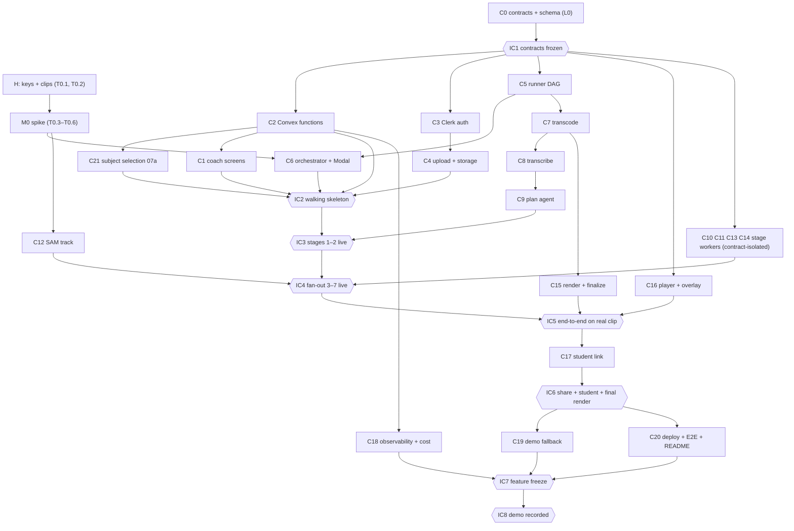

# WORKPLAN: how the build splits into parallel lanes

How to run the build as parallel work: one Codex agent per lane, parallel Codex subagents for small or contract-isolated chunks, and Bala for keys, clips and decisions. Task IDs refer to TASKS.md; contracts refer to SPEC.md.

**v1.1 (Wed 28 Oct 2026):** one selected person is tracked (DECISIONS F1). Changes here: C11 is now the subject resolver; new chunk C21 (subject selection UI). First work for Codex: the "Ready to test now" chunk in TASKS.md (no paid keys).

**Branches and PRs (Bala, 28 Oct; AGENTS.md rule 13):** each lane agent or subagent works on its own branch (`lane/<lane>-<short-topic>`, e.g. `lane/l5-local-driver`), pushes that branch and opens a PR to `main`. Never push directly to `main`, never force-push `main`, never merge its own PR: Bala reviews and merges. Each PR lists the TASKS.md IDs it covers and their passing acceptance tests. "Merges" below means "Bala merges the lane's PR".

Complexity tiers: **S** ≤ half a day, contract-isolated, few files. **M** about a day, touches 2 modules or a vendor API. **L** more than a day, or cross-cutting and stateful. Tiers are estimates, not measurements.

## 1. Rule: contracts land first

Lane L0's PRs for T1.01 → T1.02 → T1.03 are merged before any other lane's PR is merged (**IC1 · contracts frozen**). After IC1 every lane builds against:
- JSON Schemas in `packages/contracts/schemas/` (stage I/O, `ErrorCode`, `PipelineConfig`, `Provenance`),
- `convex/schema.ts` and the function names in SPEC §9,
- HTTP shapes in SPEC §10,
- the `StageWorker` interface in SPEC §6.2,
- the `VideoStorage` interface in SPEC §12.
Each lane can mock the others: the `fake` provider, `SANDBOX_DRIVER=local`, `STORAGE_DRIVER=local`, and Convex dev deployments.

## 2. Chunks

| # | Chunk | Module / dir | Inputs → outputs | Contract it depends on | Depends on | Tier (why) | Executor |
|---|---|---|---|---|---|---|---|
| C0 | Scaffold + contracts + Convex schema | root, `packages/contracts`, `convex/schema.ts` | SPEC → schemas, generated types, tables, config seed | SPEC §6–§9 | — | M (cross-cutting; everyone waits on it) | Codex lane agent L0 |
| C1 | Web app shell + coach screens 02–04, 06, 12–23 | `apps/web/app`, `apps/web/components` | Convex queries/mutations → screens | Convex functions (§9), error codes (§15), coachStages | C0, C2 for live data | L (most screens, review UX rules) | Codex lane agent L1; screens 13–16 and 21 as S-tier subagents |
| C2 | Convex functions: sessions, jobs, stageRuns rollup, review, lessons, share, `/svc`, `/worker` HTTP | `convex/` | mutations/queries/HTTP actions | schema, job token, verbatim rule | C0 | L (stateful: atomic claim, rollup, verbatim checks, snapshot) | Codex lane agent L2 |
| C3 | Clerk auth | `apps/web/middleware.ts`, `convex/auth.config.ts`, `convex/lib/auth.ts`, screen 01 | Clerk identity → `coaches` row, ownership checks | §13 | C0; keys from Bala | S (standard integration) | Codex subagent; **Bala** for Clerk keys |
| C4 | Upload + storage | `apps/web/lib/storage`, `apps/web/lib/upload`, `apps/web/app/api/uploads`, `api/media`, `api/worker/sign`; screens 07–08 | file → multipart parts → confirmed object → `jobs.enqueue` | `VideoStorage` (§12), §10.2 | C0, C3 | M (resume and checksum edge cases; two adapters) | Codex lane agent L4; R2 adapter as S subagent |
| C5 | Runner DAG + stage interface + adapters | `runner/netsense_runner/{stage,dag,fanout,adapters,providers}` | job → ordered stage calls → stageRuns | `StageWorker` (§6.2), `/worker/*` (§10.4) | C0 | L (fan-out, retries, idempotency, budget, heartbeat) | Codex lane agent L5 |
| C6 | Orchestrator + Modal lifecycle + sweeper | `services/orchestrator`, `infra/modal` | queued job → sandbox → released | `/svc/*` (§10.3), §11 | C0, C5 (runner entrypoint) | L (guaranteed release, crash recovery; vendor UNTESTED) | Codex lane agent L5 (same lane as C5); **Bala** for Modal token |
| C7 | Transcode pre-stage | `runner/.../stages/s0_transcode.py`, `media/` | source → proxy, WAV chunks, m4a, key frames | `TranscodeInput/Output` | C5 interface | S (ffmpeg recipes) | Codex subagent |
| C8 | Stage 1 transcribe | `stages/s1_transcribe.py` | WAV chunks → turns | `Transcribe*` | C7 | S (one endpoint, error map) | Codex subagent |
| C9 | Stage 2 plan agent | `stages/s2_plan.py`, `prompts/plan.md` | turns → remarks, drafts, fan-out | `Plan*`, §8.1 | C8 contract only | M (prompt + verbatim post-processing) | Codex subagent |
| C10 | Stage 3 moment agent | `stages/s3_moment.py`, `prompts/moment.md` | remark + key frames → moment | `Moment*`, §8.2 | contracts only | S (contract-isolated) | Codex subagent |
| C11 | Stage 4 subject resolver (anchor + re-identification) | `stages/s4a_subject_anchor.py`, `stages/s4_subject.py`, `rules/position_prior.py` | tap point → anchor box + reference crop; key frame + reference crop → the same person's box | `SubjectAnchor*`, `Subject*`, §7.4, §8.3 | contracts only; SAM image call; C21 for real taps | M (SAM point prompt + Spark re-id + prior; UNTESTED until S-4) | Codex subagent |
| C12 | Stage 5 SAM track (subject only, swap guard) | `stages/s5_track.py`, `sam/` | window + subject prompt → track file | `Track*` | contracts only; spike results | L (streaming parse, single-id filter, re-association, swap guard, Files API lifecycle, cache, caps; UNTESTED) | Codex subagent with lane L5 review |
| C13 | Stage 6 mark placer | `stages/s6_place.py`, `prompts/place.md` | remark + track summary → marks | `Place*`, §8.4 | contracts only | S (schema-bound, span copy) | Codex subagent |
| C14 | Stage 7 rules checker + routing | `stages/s7_check.py`, `rules/` | marks + track → verdicts | `Check*` | contracts only | S (pure functions) | Codex subagent |
| C15 | Stage 8 ffmpeg render + stills + finalize | `stages/s8_render.py`, `media/overlay_draw.py`, `finalize.py` | annotations + tracks → MP4 / JPEGs | `Render*` | C7; overlay geometry shared with C16 | M (Pillow overlay + ffmpeg segments + reuse) | Codex subagent |
| C16 | Player + live overlay (17, 18) | `apps/web/components/player`, `lib/overlay` | annotations + track JSON → canvas overlay | track file format (§7.5), geometry fixture | C0 | M (frame sync, same geometry as C15) | Codex lane agent L1 |
| C17 | Student link (22–27 backend + 24–27 UI) | `convex/share.ts`, `apps/web/app/l`, `apps/web/app/api/l`, `lib/link` | approved items → snapshot → code-checked access | §14, snapshot payload | C2, C4 (signed media) | M (security details) | Codex lane agent L8 |
| C18 | Observability + cost guards | `scripts/runs-*`, `convex/costLedger.ts`, logging modules | stageRuns/ledger → CLI views, stops | §16, §18 | C2, C5 | S (read-side + checks) | Codex subagent |
| C19 | Demo/seed fallback (labelled) | `scripts/demo-*`, `components/fallback-badge.tsx` | real processed session → bundle → import with badge | §22.4 | C2, C17 | S | Codex subagent; **Bala** supplies the real session |
| C20 | Deploy + E2E + README | `infra/vm`, `tests/e2e`, `README.md` | built app → running VM, green suite | all | everything | M (integration) | Codex lane agent L0 (integration owner); **Bala** for VM access |
| C21 | Subject selection (07a) + gating + Change who to follow | `apps/web/app/sessions/[id]/subject`, `components/subject-picker`, `lib/video/grab-frame.ts`, `convex/sessions.ts` (setSubject), `convex/jobs.ts` (enqueueWhenReady) | local file frame + tap → `sessions.subject` → job enqueued once | `Subject` (§7), §9, §10 | C0, C2; UI also C4 | M (frame decode on phones, normalised coordinates, either-order gating; no wireframe) | Codex lane agent L1 (UI) + L2 (gating) |
| H | Keys, clips, decisions, spike verdict, demo video | — | — | SETUP.md, DECISIONS.md | — | — | **Bala** (T0.1, T0.2, T0.6, T1.30 parts, T1.34) |

## 3. Dependency graph

## 4. Parallel lanes (after IC1)

| Lane | Owner | Chunks | TASKS.md IDs | Runs in parallel with |
|---|---|---|---|---|
| L0 Contracts + integration | Codex lane agent | C0, C20 | T1.01, T1.02, T1.03 (then T1.30, T1.31, T1.33) | first alone; later integrates everyone |
| L1 Web UI | Codex lane agent (+ S-tier subagents) | C1, C16, C21 (UI) | T1.07, T1.13, T1.35 (UI), T1.22, T1.23, T1.24, T1.25, UI part of T1.27 | L2, L4, L5, L6 |
| L2 Convex functions | Codex lane agent | C2, C21 (gating) | T1.03 (functions part), T1.10, T1.35 (setSubject, gating), Convex parts of T1.22, T1.24, T1.25, T1.27 | L1, L4, L5, L6 |
| L3 Auth | Codex subagent | C3 | T1.04 | everything; short |
| L4 Upload + storage | Codex lane agent | C4 | T1.05, T1.06 | L1, L2, L5, L6 |
| L5 Runner + orchestrator | Codex lane agent | C5, C6, C7 | T1.08, T1.09, T1.11, T1.12 | L1, L2, L4, L6 |
| L6 Stage workers | parallel Codex subagents, one per stage | C8–C15 | T1.14, T1.15, T1.16, T1.17, T1.18, T1.19, T1.20, T1.21, T1.26 | each other (contract-isolated, fake provider) |
| L7 Student link | Codex lane agent | C17 | T1.27, T1.28 | L6 tail, L8 |
| L8 Ops: observability, cost, demo fallback | Codex subagents | C18, C19 | T1.29, T1.32 | L7 |
| H Human | Bala | H | T0.1, T0.2, T0.6, parts of T1.04, T1.11, T1.30, T1.31 (live smoke), T1.34; all of DECISIONS.md | always |
| Spike | Codex agent with Bala | — | T0.3, T0.4, T0.5 | L0 (no shared files) |

Notes:
- **Start here (no paid keys):** the "Ready to test now" chunk in TASKS.md runs L0 → L5 (local driver) → L2/L1 (C21) → IC2.
- Every lane works on its own branch and reaches `main` only through a PR that Bala merges (see top).
- L6 stage subagents only need the contracts and the fake provider; real-key runs happen at IC3/IC4 on Bala's keys.
- C12 (SAM) waits for spike numbers before tuning, but the parser and Files API lifecycle can be built against synthetic stream text.
- C15 and C16 share the overlay geometry: agree on `fixtures/synthetic/overlay-geometry.json` first; both test against it.

## 5. Merge points and integration checkpoints

| ID | When (SGT, target) | Merges | Integration check |
|---|---|---|---|
| IC1 | Wed 28 Oct, end of day | L0 | `pnpm check` green; schemas lint against Muse Spark limits; Convex dev deploys; every lane rebases |
| IC2 | Thu 29 Oct, midday | L2 + L3 + L4 + L5 + L1 (status screen, 07a) | Walking skeleton: synthetic clip upload → tap subject on 07a → job → sandbox (local, and Modal if T0.4 passed) → fake stages → screen 12 complete → sandbox released (`runs:sandboxes --open` empty) |
| IC3 | Thu 29 Oct, end of day (checkpoint: decide cuts 6–9 trend) | C7, C8, C9 | Real spike clip: transcribe + plan produce remarks with verbatim words; stageRuns visible |
| IC4 | Fri 30 Oct | C10–C14 | Real clip: per-remark 3–7 under the fan-out cap; one forced failure does not block others; 16 shows (incl. swap variant); only the selected person is tracked |
| IC5 | Sat 31 Oct, 11:59 PM (end-to-end checkpoint; decide cuts 6–9) | C15, C16, review screens | Real clip on a phone: upload → tap subject → status → playback with preview render or live overlay → review approve/move |
| IC6 | Sun 1 Nov | C17, finalize | Share → student on a second device → code → lesson → focus; final render in a fresh sandbox released |
| IC7 | Mon 2 Nov (feature freeze) | C18, C19, C20 | Deployed on the VM; E2E green; live smoke green; secret scan clean; demo fallback badge checked |
| IC8 | Tue 3 Nov | — | Demo video recorded (RUNBOOK checklist); package to Bala Wed 4 Nov 2 PM, internal submit target 8 PM; deadline Thu 5 Nov 10:00 AM |

## 6. TASKS.md → lanes

| Task | Lane | Chunk | Executor |
|---|---|---|---|
| T0.1, T0.2, T0.6 | H | H | Bala |
| T0.3, T0.4, T0.5 | Spike | — | Codex agent + Bala keys |
| T1.01, T1.02, T1.03 | L0 (+L2 for functions) | C0, C2 | Codex lane agent |
| T1.04 | L3 | C3 | Codex subagent + Bala keys |
| T1.05, T1.06 | L4 | C4 | Codex lane agent |
| T1.07, T1.13, T1.22 | L1 | C1 | Codex lane agent / subagents |
| T1.35 | L1 (UI) + L2 (gating) | C21 | Codex lane agents |
| T1.08, T1.09, T1.11, T1.12 | L5 | C5, C6, C7 | Codex lane agent |
| T1.10 | L2 | C2 | Codex lane agent |
| T1.14 – T1.21 | L6 | C8 – C15 | one Codex subagent per stage |
| T1.23, T1.24, T1.25 | L1 (+L2) | C16, C1 | Codex lane agent |
| T1.26 | L6 | C15 | Codex subagent |
| T1.27, T1.28 | L7 | C17 | Codex lane agent |
| T1.29, T1.32 | L8 | C18, C19 | Codex subagents |
| T1.30, T1.31, T1.33 | L0 | C20 | Codex lane agent + Bala |
| T1.34 | H | H | Bala |
| X1–X8 | owner lane of the chunk they extend | — | after IC7 only if time allows |
